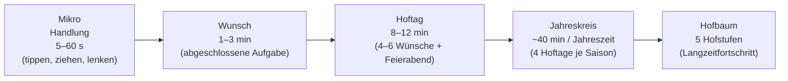
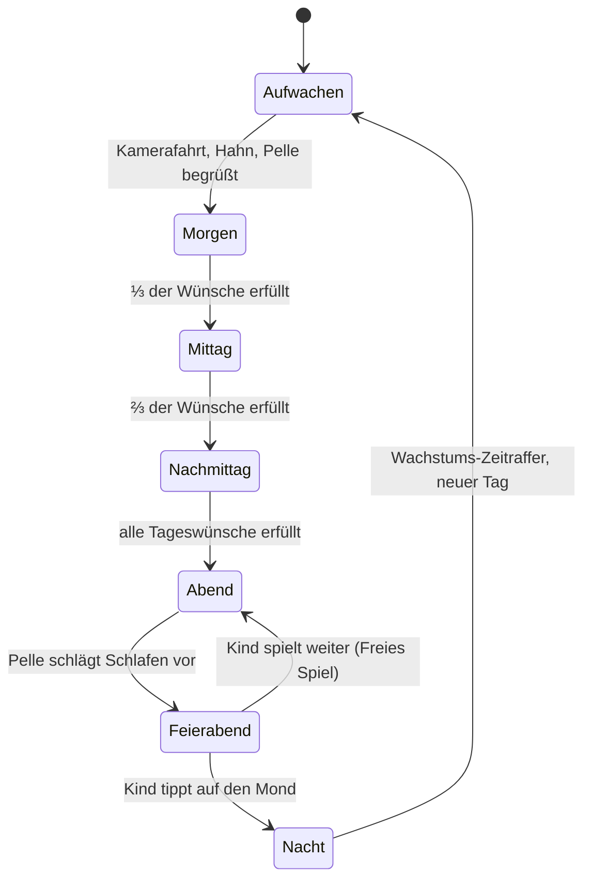

# 03 – Spielablauf, Fortschritt und Onboarding

## 1. Spielschleifen auf vier Ebenen

| Ebene | Dauer | Kernfrage | Belohnung |
|---|---|---|---|
| **Mikro** | 5–60 s | „Was passiert, wenn ich das anfasse?“ | Sofortige Animation, Ton, Partikel, Haptik |
| **Wunsch** | 1–3 min | „Kann ich dem Tier/Beet/Kunden helfen?“ | Pelle lobt konkret, Bubble platzt in Herzen/Blüten, Sonne rückt weiter |
| **Hoftag** | 8–12 min | „Was haben wir heute geschafft?“ | Feierabend-Ritual, Nacht-Zeitraffer, Tagesbild |
| **Jahreskreis & Hofbaum** | Stunden | „Wie sieht mein Hof nächstes Jahr aus?“ | Neue Orte, Tiere, Maschinen, Deko, Hoffest |

## 2. Der Hoftag

Ein Hoftag ist die zentrale Struktur des Spiels. Zeit vergeht **nicht in Echtzeit**, sondern **durch Handlungen**: Jeder erfüllte Wunsch rückt die Sonne ein Stück auf dem **Sonnenbogen** weiter.

### 2.1 Phasen im Detail

| Phase | Licht/Stimmung | Typische Wünsche | Audio |
|---|---|---|---|
| **Aufwachen** | Sonnenaufgang, goldener Dunst | Überraschung über Nacht: Pflanzen sind gewachsen, Briefkasten blinkt | Hahn, Vögel, Pelle „Guten Morgen!“ |
| **Morgen** | Frisch, kühle Blautöne → warm | Tiere füttern, Eier suchen, Beete gießen | Akustikgitarre, leise |
| **Mittag** | Hell, kurze Schatten | Feldarbeit, Traktor, Ernte | Heller, fröhlicher |
| **Nachmittag** | Weiches Gold | Laden, Verarbeitung, Kunden | Entspannt |
| **Abend** | Orange/Rosa, lange Schatten | Tiere in den Stall bringen, Hof aufräumen (optional) | Grillen/Windspiel |
| **Feierabend** | Dämmerung, Lichterketten an | Pelle: „Ich bin müde. Gehen wir schlafen?“ | Spieluhr |
| **Nacht** | Sanftes Blau, Glühwürmchen, Mond | Zeitraffer-Wachstum, Tagesbild | Sehr leise, Schlaflied-Motiv |

### 2.2 Wunschverteilung pro Tag

| Stufe | Wünsche/Tag | Gleichzeitig sichtbar | Zusatz-Impulse |
|---|---|---|---|
| Keimling | 4 | 1–2 | 1 Überraschung (z. B. Schmetterling, Regenbogen) |
| Spross | 5 | 2–3 | 1–2 Überraschungen |
| Blüte | 6 | 3–5 | 1–2 Überraschungen + 1 „Tüftel-Wunsch“ (freiwillig) |

Regeln für die Auswahl der Wünsche sind in Dokument 09 §5 (Wunsch-Generator) beschrieben. Wesentlich:

- Jeder Tag enthält mindestens: **1 Tierwunsch**, **1 Feldwunsch**, **1 Ladenwunsch** (sobald freigeschaltet).
- Nie derselbe Ort zweimal hintereinander (außer das Kind bleibt freiwillig dort).
- Wünsche **verfallen nie** – sie bleiben über Tage bestehen und gehen nie verloren.
- Das Kind darf Wünsche ignorieren. Nach „sinnvollen Handlungen“ (siehe 2.3) rückt die Sonne trotzdem weiter.

### 2.3 Zeitfortschritt im Freien Spiel

Wenn das Kind Wünsche ignoriert und stattdessen frei spielt (Beete bepflanzen, Tiere streicheln, mit dem Traktor kreisen), rückt die Sonne durch **Aktivitäts-Ticks** weiter:

- Sinnvolle Handlung (säen, gießen, ernten, füttern, streicheln, liefern, fahren > 10 s) = **0,25 Wunsch-Äquivalent**.
- Spam-Schutz: Dieselbe Handlung am selben Objekt zählt nur einmal je Tag und Objekt.
- So endet der Tag auch ohne erfüllte Wünsche in 15–20 Min. natürlich; Pelle schlägt dann Feierabend vor.

### 2.4 Die Nacht (Wachstums-Zeitraffer)

- Dauer 8–12 s, **immer überspringbar** (Tippen → beschleunigt, nicht abgebrochen).
- Kamerabewegung langsam über den Hof; Pflanzen wachsen sichtbar eine Stufe; Tiere schlafen; Fensterlichter gehen aus.
- Danach: **Tagesbild** (Icons der heutigen Taten, von Pelle vorgelesen) – 5 s, überspringbar.
- Gespeichert wird **vor** Beginn der Nachtsequenz (siehe Doku 15 §8, Autosave).

## 3. Der Hofbaum – sichtbarer Langzeitfortschritt

Im Zentrum des Hofplatzes steht ein großer **Hofbaum** (Apfel-/Linden-Charakter). Er ist die *eine* Fortschrittsanzeige. Er wächst, wenn das Kind Wünsche erfüllt – nicht durch Zahlen, sondern durch Blätter, Blüten, Früchte, Lichterketten, ein Baumhaus, ein Vogelhaus.

### 3.1 Hofstufen

| Hofstufe | Name (intern) | Schwelle | Neu freigeschaltet (Auswahl) |
|---|---|---|---|
| **1** | Hofanfang | Start | Hofplatz, Gemüsegarten (6 Beete), Hühnerhaus (3 Hühner), kleiner Hofladen-Stand; **Pelle**, Bäckerin **Tilda**; Saat: Radieschen, Karotte, Salat; Gießkanne |
| **2** | Wachsender Hof | 10 Wünsche, ≥ 3 versch. Aktivitätsarten | Garage + **Traktor** + Pflug + Sämaschine; kleiner Acker; **Kuhstall** (Kühe); Saat: Erbse, Kartoffel; Opa **Hanno** |
| **3** | Hof mit Herz | 30 Wünsche, ≥ 6 Arten | **Schafweide**, **Schweinekoben**; Wasserfass, Mähwerk; **Obstwiese** (Apfelbäume); Saat: Tomate, Mais, Sonnenblume, Erdbeere; **Mo** (Nachbarskind) |
| **4** | Großer Hof | 60 Wünsche, ≥ 10 Arten | **Mähdrescher**, Kartoffelroder, Ballenpresse, Frontlader; Weizen, Kürbis; **Hofküche** (Mühle, Backofen, Saftpresse, Butterfass); Ziegen, Enten; **Gewächshaus**; Postbotin **Lale**, Marktstand-Verkäufer **Yusuf** |
| **5** | Der Hof lebt | 100 Wünsche, ≥ 14 Arten | **Pferd + Kutsche**, Kaninchen, Bienenstock; Schneeschild; Deko-Editor voll; **Dorfmarkt** (Traktor + Anhänger fahren); **Hoffest** pro Jahreszeit |

> Die Schwellen sind Startwerte. Durch „≥ N verschiedene Aktivitätsarten“ wird verhindert, dass ein Kind eine Stufe nur durch Wiederholen *einer* Tätigkeit erreicht – sie sind aber ebenso kein Gatekeeping: Alle Schwellen lassen sich im normalen Spiel ohne Absicht erreichen. Mit Hofstufe 5 ist **alles** freigeschaltet, es gibt keine Paywalls und keine zeitlichen Barrieren.

### 3.2 Stufenaufstieg (Hoffest-Zeremonie)

- Auslöser: Der letzte nötige Wunsch wird erfüllt.
- Ablauf (30–45 s, überspringbar mit Tipp *nach* 5 s): Hofbaum glitzert, Glocke, Pelle jubelt, neue Dinge „wachsen“ auf der Karte (Gebäude hebt sich, Tor öffnet sich), Briefträgerin Lale liefert ein Paket (Kind zieht an der Schleife) – Inhalt: neues Saatgut, Tier oder Maschine.
- Immer **Kind-getriggert**: Paket wird erst geöffnet, wenn das Kind zieht (keine Hast).

## 4. Das Hofbuch (Sammelalbum)

Ein bebildertes **Hofbuch** (Icon: aufgeschlagenes Buch am Hofplatz oder Rucksack-Menü) füllt sich automatisch.

| Seite | Inhalt | Füllt sich durch |
|---|---|---|
| Pflanzen | Alle Kulturen mit 4 Wachstumsstadien | Säen und Ernten |
| Tiere | Alle Tiere + Babys + Töne | Tier kennenlernen (streicheln, füttern) |
| Maschinen | Alle Fahrzeuge | Erste Fahrt |
| Dorfbewohner | Alle Charaktere | Erste Begegnung |
| Jahreszeiten | 4 Seiten mit Saison-Entdeckungen | Saison-Aktivitäten |
| Entdeckungen | Überraschungen, Easter Eggs | Neugierige Berührungen |

- Unentdeckte Einträge sind **Silhouetten** („Was fehlt hier noch?“ → Neugier, kein Druck).
- Tippen auf einen Eintrag: Pelle spricht den Namen und einen Fun-Fakt (Wortschatz, Sachwissen), spielt Tier-/Maschinengeräusch.
- Keine „Vollständigkeits-Prozent“. Keine Belohnung für 100 %. Nur Freude am Entdecken.

## 5. Freies Spiel (Sandbox)

- Jederzeit verfügbar, **kein Moduswechsel** nötig: Wünsche sind optional; das Kind kann ohne Ziel spielen.
- Optionaler **Hof-Designmodus** (ab Hofstufe 3): Dekoration, Wege, Zäune, Blumenbeete platzieren (Raster, Snap, Drehen per Tipp, Löschen per Ziehen in den Papierkorb-Korb; kein Verlust von Items, sie kehren ins Inventar zurück).
- Optionaler **Traktor-Freifahrmodus**: fahren, hupen, Spuren ziehen, Furchenmuster erzeugen.
- **Fotomodus** *(Phase 3 / optional)*: Pelle fotografiert; Bilder bleiben lokal in der App, Teilen nur hinter Parental Gate.

## 6. Sitzungsgestaltung & sanftes Ende

| Mechanik | Beschreibung |
|---|---|
| **Natürliche Pausen** | Der Feierabend am Hoftag-Ende ist der natürliche Ausstiegspunkt. |
| **Spielzeit-Erinnerung (Eltern)** | Eltern stellen im Elternbereich z. B. 15/30/45 Min. ein. Dann: Pelle gähnt, sagt „Der Hof wird müde …“; es wird Abend; nach dem Schlafen kehrt das Spiel zum Profilbildschirm zurück. Kein harter Abbruch mitten in einer Handlung – die aktuelle Handlung wird beendet. |
| **Keine Suchtmechaniken** | Keine Tagesbelohnungen, keine Serien, keine „Komm morgen wieder“-Hooks, keine Push-Nachrichten, keine zeitlimitierten Events. |
| **Wiedereinstieg** | Immer freundlich: „Hallo! Schön, dass du wieder da bist!“ Der Hof wartet unverändert (Echtzeit hat keinen Einfluss auf den Spielzustand). |
| **Mitten in einem Wunsch aufgehört?** | Das Spiel speichert Wunsch + Schritt; beim Wiedereinstieg: Pelle erinnert freundlich („Wir wollten gerade Kartoffeln ernten!“) mit Zusatz-Hinweisgeste. |

## 7. Onboarding / First-Time-User-Experience (FTUE)

**Ziel:** Das Kind erlebt in **≤ 5 Minuten** den vollen Zyklus *säen → gießen → schlafen → ernten → verkaufen*, ohne dass je ein „Tutorial“ erkennbar ist.

### 7.1 Eltern-Einrichtung (einmalig, ≤ 60 Sekunden, Text erlaubt)

1. Willkommen (Pelle spricht, Elternhinweis „Dieses Spiel braucht keine Internetverbindung“).
2. Profil anlegen: Tier-Avatar wählen (6 Tiere), Altersstufe (3–4 / 5–6 / 7–8), optional: **Namen aufnehmen** (Mikrofon-Berechtigung nur dafür; Audio bleibt lokal – siehe Doku 17).
3. Sprache und Lautstärke (Test-„Wuff!“).
4. Hinweis: „Elternbereich: Hier oben links gedrückt halten.“ → Übergabe ans Kind.

### 7.2 Kind-Einstieg (Minute für Minute)

| Zeit | Szene | Pelle (gesprochen, sinngemäß) | Kind tut | Erfolg |
|---|---|---|---|---|
| 0:00 | Kamera fährt aus den Wolken über den kleinen Hof; Pelle springt ins Bild | „Hallo! Ich bin Pelle! Willkommen auf dem Hof!“ | Wartet / tippt auf Pelle | Pelle bellt freudig |
| 0:30 | Ein Beet blinkt; Samentüte „Radieschen“ schwebt | „Schau mal, ein Samen! Tipp auf den Samen!“ | Tippt Samen → Samen in der Hand (Handschuh) | Sticky Touch |
| 0:50 | Beet leuchtet | „Leg ihn ins Beet!“ (Geisterhand zeigt Weg) | Zieht/tippt auf Beet | Samen wird gepflanzt, Erde „plöpp“ |
| 1:20 | Gießkanne erscheint | „Jetzt trinken die Pflänzchen. Gieß mit der Kanne!“ | Tippt Kanne → tippt Beet | Wasser-Partikel, kleines Spross-Wunder (Keimling erscheint **sofort** beim ersten Mal) |
| 2:00 | Sonne rückt auf Mittag | „Super! Jetzt noch Hühner füttern.“ | Tippt Futter → Tipp auf Huhn | Hühner picken, Küken-Tippelgeräusch |
| 3:00 | Sonne untergehend | „Ich bin müde. Gehen wir schlafen?“ (Mond leuchtet) | Tippt Mond | Nacht-Zeitraffer |
| 3:30 | Morgen | „Guten Morgen! Schau, die Radieschen sind groß!“ | Tippt Radieschen → in den Korb | Ernte-Jubel, Pop |
| 4:30 | Tilda am Hofladen-Stand | „Tilda möchte ein Radieschen. Gibst du ihr eins?“ | Zieht Radieschen zu Tilda | Tilda „Danke!“, Taler-Klimpern |
| 5:00 | Hofbaum bekommt erstes Blatt | „Der Hofbaum freut sich! Du bist ein toller Hofhelfer!“ | – | Erste Hofbaum-Blüte, freies Spiel |

### 7.3 Designregeln fürs Onboarding

- Kein „Tutorial“-Banner, keine Pfeile aus Text. Erklären nur über **Pelle + Geisterhand + Leuchten**.
- Jeder Schritt wartet **unbegrenzt** auf das Kind. Nach der Hinweisleiter (Doku 10) wird der Schritt zusammen ausgeführt.
- Beim ersten Mal ist das Wachstum **sofort sichtbar** (verkürzte Wartezeit), damit Ursache–Wirkung unmittelbar erlebt wird.
- Gestik-Einführung (Ziehen, Halten) erfolgt erst ab 2. Hoftag und nur, wenn Mastery es zulässt.

## 8. Fortschrittsprinzipien (Zusammenfassung)

1. Fortschritt ist **ein Geschenk**, keine Währung: Er wird *gezeigt* (Hofbaum, neue Dinge), nicht *gezählt*.
2. Nichts ist an Echtzeit gebunden, nichts verfällt.
3. Jede Aktivität hat **mehrere sinnvolle Pfade** (Wunsch erfüllen, frei spielen, Hofbuch erkunden, dekorieren).
4. Das Spiel fördert **Wiederholung**: Dasselbe Beet 10× bepflanzen ist legitimes Spiel.
5. Wiederholung führt nie zur Abstumpfung: Varianten (Saison, Wetter, Besucher, Tierlaunen) halten die Szenen frisch.
