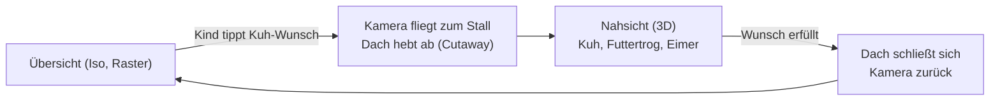

# 04 – Welt, Orte und Kamera (2.5D-Logik, 3D-Erlebnis)

## 1. Grundidee: Diorama-Hof

Der Hof schwebt als **Hofinsel** (Diorama) auf dem Bildschirm: eine Wiesen-Scholle mit sichtbarer Erdschicht an den Rändern, weicher Dunst-Horizont, Himmel mit Wolken. Das fühlt sich an wie ein liebevolles Spielzeug-Diorama – überschaubar, geborgen, gut lesbar auch auf kleinen iPhones.

- **Spiellogik: 2.5D** – Die Welt liegt auf einem **Kachelraster** (X/Z). Alles Wichtige (Beete, Wege, Platzierung, Pfade, Zielerkennung) wird auf dem Raster berechnet. Das macht die Bedienung für Kinder berechenbar und das Verhalten robust.
- **Darstellung & Erlebnis: echtes 3D** – Alle Objekte sind 3D-Modelle (RealityKit), mit Licht, Schatten, Physik-Anmutung und Animation. Bestimmte Momente wechseln die Kamera in **echte 3D-Nähe** (Tierpflege, Hofladen, Mähdrescher-Cockpit-Sicht ab Stufe „Blüte“).
- **Die Insel wächst mit dem Hofbaum** (5 Ausbaustufen, jeweils ein Ring dazu).

### 1.1 Raster & Größen

| Parameter | Wert |
|---|---|
| Kachelgröße | 1 × 1 Weltmeter (Maßstab: 1 Kachel ≈ ein großes Gemüsebeet) |
| Hofinsel Stufe 1 | 16 × 12 Kacheln |
| Stufe 2 | 22 × 16 |
| Stufe 3 | 28 × 20 |
| Stufe 4 | 34 × 24 |
| Stufe 5 | 40 × 28 |
| Höhenstufen | 0 (Wiese), 1 (kleine Erhöhung: Hofplatz/Pflaster), Teich −1 |

Platzierungen (Gebäude, Deko) rasten ein (Snap) auf ganze Kacheln; Drehung in 90°-Schritten.

## 2. Hof-Layout (Endausbau, schematisch)

```
                  N
   ┌───────────────────────────────────────────────┐
   │  Pferdekoppel   Ziegengehege   Schafweide     │
   │  ┌────┐         ┌────┐         ┌──────────┐    │
   │  │ 🐴 │         │ 🐐 │         │ 🐑 🐑     │    │
   │  └────┘         └────┘         └──────────┘    │
   │                                                │
   │   Acker (groß)             Obstwiese            │
   │  ┌──────────────┐        ┌──────────┐          │
   │  │ ▒▒▒▒▒▒▒▒▒▒▒▒ │        │ 🍎 🍎 🍎 │          │
   │  │ ▒▒▒▒▒▒▒▒▒▒▒▒ │        └──────────┘          │
   │  └──────────────┘                              │
 W │    Gemüsegarten    ★ HOFPLATZ ★     Stallgasse   │ E
   │  ┌────────┐     (Hofbaum, Brunnen,  ┌────────┐ │
   │  │ 🥕 🥬 🍅│      Briefkasten)       │Kuhstall│ │
   │  └────────┘                         │Schwein │ │
   │   Gewächshaus   Hofladen   Hofküche  │Hühner  │ │
   │                                       └────────┘ │
   │  Maschinenhalle        Ententeich    Straße →     │
   │                                       (Dorfmarkt) │
   └───────────────────────────────────────────────┘
                  S
```

Der **Hofplatz** ist Zentrum und Orientierungspunkt. Alle Orte sind zu Fuß/Finger in ≤ 2 Wischern erreichbar.

## 3. Orte im Detail

| Ort | Ab Hofstufe | Funktion | Interaktionen (Beispiele) | 3D-Nahsicht |
|---|---|---|---|---|
| **Hofplatz** | 1 | Zentrum, Hofbaum, Brunnen, Briefkasten, Windrad | Hofbaum streicheln (Blätter rieseln), Brunnen pumpen, Post öffnen | – |
| **Gemüsegarten** | 1 | 6 → 12 → 18 Hand-Beete (Kisten) | Säen, Gießen, Ernten (von Hand), Unkraut zupfen (optional), Vogelscheuche | leichte Schrägsicht beim Ernten |
| **Hühnerhaus** | 1 | 3 → 6 Hühner, Küken im Frühling | Füttern, Eier suchen/sammeln, streicheln | Stall-Cutaway: Dach hebt sich |
| **Hofladen** | 1 (Stand) → 3 (Haus) | Verkaufen, Kunden bedienen | Regal füllen, Korb packen, Münzen | Tresen-Perspektive |
| **Maschinenhalle** | 2 | Garage für Traktor + Anbaugeräte | Gerät ankoppeln, Traktor waschen, Farbe wählen | Garagen-Cutaway |
| **Acker** | 2 | Großfeld (4×4 → 8×6 → 12×8 Kacheln) | Pflügen, Säen, Wassern, Ernten mit Maschine | Verfolgerkamera |
| **Kuhstall** | 2 | Kühe, Kalb | Füttern, Melken, Bürsten, Muhen | Stall-Cutaway, Nähe |
| **Schafweide** | 3 | Schafe, Lämmer | Zählen, Hüten (Pelle hilft), Scheren, Streicheln | Wiese, Pelle läuft |
| **Schweinekoben** | 3 | Schweine, Ferkel | Matschbad, Futter, Waschen | Nahsicht |
| **Obstwiese** | 3 | Apfelbäume (4 → 8) | Äpfel pflücken (Leiter/Frontlader/Schüttler), Fallobst sammeln | Baum-Nahsicht |
| **Hofküche** | 4 | Mühle, Backofen, Saftpresse, Butterfass, Marmeladenkessel, Eismaschine | Verarbeiten (Produktionsketten, siehe Doku 07) | Küchen-Nahsicht |
| **Gewächshaus** | 4 | Winteranbau, Kräuter | Säen, Gießen (auch im Winter), Marienkäfer | Innenansicht |
| **Ententeich** | 4 | Enten, Frösche, Seerosen | Füttern, Boot, Wasserläufer | Teich-Nahsicht |
| **Ziegengehege** | 4 | Ziegen, Kletterfelsen | Füttern, Klettern lassen | Nahsicht |
| **Pferdekoppel** | 5 | Pferd, Fohlen, Kutsche | Striegeln, Füttern, Kutschfahrt zum Dorfmarkt | Nahsicht, Chase-Cam |
| **Bienenstock** | 5 | Bienen, Blumenwiese | Blumen pflücken für Bienen, Honig schleudern | Nahsicht |
| **Dorfmarkt** | 5 | Eigene kleine Karte (Straße, Marktplatz, 4 Stände) | Mit Anhänger hinfahren, Stand aufbauen, an Kunden verkaufen | Chase-Cam |

## 4. Navigation (kinderleicht)

Kinder müssen nie „suchen“. Drei sich ergänzende Wege:

1. **Pelle-Fokus (Hauptweg):** Tippen auf Pelle (oder den Hund-Button) → Pelle läuft zum aktuellen Wunsch, die Kamera fährt mit. Das Kind muss nur folgen.
2. **Wunschblasen:** Tippen auf eine Wunschblase am Bildschirmrand (Pfeil-Blase zeigt in Richtung) → die Kamera fliegt hin.
3. **Orte-Leiste:** Unten eine Leiste mit 4–6 großen **Bild-Symbolen** (Garten, Acker, Stall, Laden …). Tippen → Kamera gleitet hin (je Ort ein eigener Jingle, damit sich auch Akustik einprägt). Die Leiste zeigt nur freigeschaltete Orte.
4. **Freies Wischen (ab Spross, optional):** Karte per Wischen verschieben, mit sanfter Trägheit und Rückfederung an den Rändern. Bei Keimling aus (Kamera nur automatisch), um ein Verlorengehen zu verhindern.

Kamera nie „verloren“: Eine **Heimat-Taste** (Haus-Symbol) bringt jederzeit zum Hofplatz zurück.

## 5. Kamera-System

### 5.1 Kamera-Rig

```
CameraRig (Entity)           // Position: Fokuspunkt auf dem Raster (pan)
 └─ Yaw (Entity)             // Drehung um Y: 45° Standard (isometrisch); 90°-Snaps ab Stufe „Blüte“
     └─ Pitch (Entity)       // Neigung: 35°–40° Standard; 15°–20° Nahsicht
         └─ Dolly (Entity)   // Abstand (zoom)
             └─ Camera       // PerspectiveCameraComponent (Option: Orthographic)
```

### 5.2 Kameramodi

| Modus | Winkel (Pitch/Yaw) | Verwendung | Eingabe |
|---|---|---|---|
| **Übersicht (Iso)** | 38° / 45° | Hofplatz, Beete, Navigation | Auto (Keimling), Pinch/Pan (ab Spross) |
| **Aufgaben-Kamera** | 45° / 45°, näher (×1.4–1.8) | Bei Wunsch (Beete, Laden) | Auto |
| **Nahsicht** | 15°–25° / frei | Tierpflege, Hofladen-Tresen, Hofküche | Auto; Kind kann die Tiere antippen |
| **Verfolgerkamera** | 30° / dem Fahrzeug folgend | Traktor, Mähdrescher, Kutsche | Auto; „Blüte“: zusätzlich Fahrersicht |
| **Kino** | frei | Hoffest, Nacht, Intro | Fest geskriptet (überspringbar) |

### 5.3 Perspektive

- **Standard:** schwach perspektivisch (FOV ≈ 22–28°), das wirkt „isometrisch“, behält aber Tiefenparallaxe, Schatten und räumliches 3D-Gefühl bei Kamerabewegungen.
- **Option/Spike:** `OrthographicCameraComponent` (iOS 18+) für reine Iso-Ansicht; im Look-Dev-Spike (Doku 19) A/B-testen. Entscheidung später.
- **Safe Areas:** Die Kamera berücksichtigt Notch/Dynamic Island und Home-Indikator; Fokuspunkt liegt leicht über Bildschirmmitte (mehr Platz für Hand-UI unten).

### 5.4 Kamera-Bewegungsregeln (Komfort)

- Immer **Ease-in/Ease-out**, 0,8–1,2 s Übergänge, nie harte Schnitte (außer Reduce-Motion/Skip).
- Keine Bildschirmwackler (kein Camera-Shake), kein Zoom-Pulsieren.
- Maximale Winkelgeschwindigkeit: 45°/s, Zoom ≤ 1,5×/s.
- **Reduce Motion** (iOS-Einstellung oder Elternschalter): Kamera springt per Überblendung statt zu fahren; Nacht-Zeitraffer wird zu Standbild-Crossfade.
- Wände/Dächer, die die Sicht verdecken, werden per **Cutaway** ausgeblendet (Dach hebt ab, Wand-Alpha), nicht durch Kameramanöver.

## 6. Von 2.5D nach 3D – Übergänge

Bestimmte Wünsche erzeugen einen **weichen Wechsel** von der Raster-Übersicht in eine 3D-Nahsicht:



- Die Logik bleibt **rasterbasiert** (Ziel-Slots, Drop-Zonen, Pfade als Kachelreihen); die Nahsicht ist nur eine andere Kamera auf dieselbe Szene – kein Szenenwechsel, kein Ladebildschirm.
- Interaktions-Hitboxen sind für die Nahsicht **separat** dimensioniert (größer, einfacher zu treffen).
- Physikalische Anmutung (Eier rollen, Äpfel plumpsen, Eimer schwappt) wird per leichter Physik oder gescripteter Animation erzeugt (Details Doku 15 §6). Deterministisch und **ohne** Fehlzustände (z. B. keine zerbrechenden Dinge, keine Gegenstände, die aus der Welt fallen).

## 7. Lebendige Welt („Idle Life“)

Der Hof ist nie statisch. Die Welt reagiert auch ohne Eingabe:

| Ebene | Beispiele |
|---|---|
| **Natur** | Gräser wiegen im Wind, Bäume rascheln, Wolken ziehen und werfen Schatten, Schmetterlinge/Libellen (saisonabhängig) |
| **Tiere** | Hühner picken, Kühe kauen, Schafe grasen, Katze **Minka** streunt, Vögel landen auf dem Zaun |
| **Gebäude** | Windrad dreht sich (Windstärke), Schornstein raucht, Fensterlichter abends |
| **Pelle** | Schnuppert, rollt sich zusammen, schläft bei langer Inaktivität (Hinweis: bei Inaktivität > 20 s kommt er und stupst) |
| **Besucher** | Briefträgerin Lale, Dorfbewohner, Igel, Eichhörnchen – alles freundlich, nichts Bedrohliches |
| **Wetter** | siehe Doku 08 |

### Berührbare Details (Neugier-Belohnung)
Mindestens **60 berührbare Details** im Vollausbau (Windrad anstupsen, Briefkasten, Vogelhäuschen, Schmetterling fangen, Ameisenstraße, Pilzring, Frosch hüpft, Ofen-Klappe, Glocke läuten …). Jede Reaktion: ≤ 2 s, freundlich, mit Sound. Neue Entdeckungen füllen die Hofbuch-Seite „Entdeckungen“.

## 8. Sicherheit & Gefühl (Weltgestaltung)

- Keine bedrohlichen Elemente: keine Raubtiere, die jagen, keine Unwetter mit Donner/Blitzen (Regen = sanft, Gewitter nie), keine Dunkelheit ohne Lichtquellen (Mond, Laternen, Glühwürmchen).
- Keine Kanten/Abgründe, die Angst machen (Insel-Rand hat Zaun/Hecke, Kamera kann nicht „herunterschauen“).
- Wasser ist flach und sicher; Tiere ertrinken nicht, Fahrzeuge stürzen nicht ab, Kollisionen führen zu weichem „Bounce“ mit Lachen-Soundeffekt („Boing!“).
- Klar erkennbare Ränder zwischen begehbarem Hof und Deko, damit Kinder nie „festhängen“.

## 9. Orientierung für Nicht-Leser

- Jeder Ort hat **Farbe + Symbol + Jingle** (Beispiel: Garten = grün + Blatt + Flöte, Stall = braun + Kuhkopf + tiefe Glocke, Laden = rot-weiß gestreift + Korb + Kassenklingel).
- Wunschblasen zeigen **immer ein Symbolpaar**: *Wer?* (Tier/Beet/Kunde) + *Was?* (Wasser/Futter/Apfel).
- Pelle benennt Orte und Dinge jedes Mal gleich („der Kuhstall“, nicht mal „Stall“, mal „Haus“).
