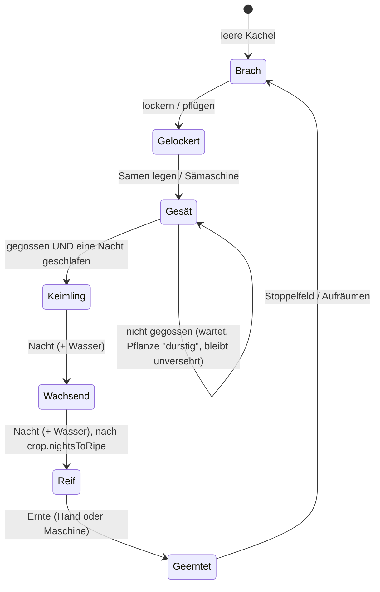

# 05 – Felder, Saatgut, Ernte und Maschinen

> Kernversprechen: **Säen, Wachsen, Ernten** ist der ruhige Herzschlag des Spiels. Nichts verwelkt, nichts geht kaputt, nichts ist knapp.

## 1. Ackerbau-Zyklus

### Regeln des Zyklus

| Regel | Wirkung |
|---|---|
| **Wasser** | Jede Nacht benötigt die Pflanze „Wasser“, um eine Wachstumsstufe weiterzukommen. Regen gießt automatisch. Ungegossene Pflanzen *warten* und zeigen eine kleine **Wassertropfen-Blase** („durstig“). **Sie sterben nie.** |
| **Nächte statt Echtzeit** | Wachstum läuft pro *Hoftag-Nacht*, nie in Echtzeit. |
| **Saison** | Saatgut ist je Jahreszeit auswählbar (siehe §3). Außerhalb der Saison „schläft“ das Saatgut (Mond-Symbol); im Gewächshaus sind warme Kulturen ganzjährig möglich. |
| **Ertrag** | Jede reife Kachel liefert 2–6 Stück (je Kultur). Ernte geht in das **Lager** (unbegrenzte Kapazität, visualisiert durch Erntekisten am Hofplatz). |
| **Unreif antippen** | Pflanze kichert/wackelt kurz; Pelle: „Die muss noch ein bisschen schlafen.“ (kein Fehlerton). |
| **Wetter** | Wetter beeinflusst nur *Stimmung und Aufgaben* (z. B. Regen = Gießen entfällt, dafür Pfützen), nie Überleben. |

## 2. Feldtypen

| Feldtyp | Ort | Größe | Bearbeitung | Hofstufe |
|---|---|---|---|---|
| **Gemüsegarten (Handbeete)** | Gemüsegarten | 6 → 12 → 18 Beete (je 1 Kachel) | Von Hand: Säen, Gießen, Ernten | 1 |
| **Acker** | Acker | 4×4 → 8×6 → 12×8 Kacheln | **Mit Maschinen** in Reihen/Spuren | 2 |
| **Obstwiese** | Obstwiese | 4 → 8 Bäume | Von Hand mit Leiter, Frontlader, Schüttler | 3 |
| **Gewächshaus** | Gewächshaus | 6 Beete | Von Hand, ganzjährig | 4 |

### Handbeet (Gemüsegarten) – Handlungskette

| Schritt | Geste Keimling | Geste Spross | Geste Blüte |
|---|---|---|---|
| 1. Samen wählen | Tipp auf Tütchen (2–3 Auswahlen) | Tütchen aus Regal ziehen (3–5 Auswahlen) | Tütchen merken (Wunsch nennt Kultur), 5–8 Auswahlen |
| 2. Säen | Tipp aufs Beet | Samen ziehen & ablegen (Drop-Radius groß) | Samen in Reihen legen (mehrere Beete in einem Zug, Linie ziehen) |
| 3. Gießen | Tipp Gießkanne → Tipp Beet | Kanne ziehen, über Beet halten (0,6 s) | Kanne kippen (Geräte-Neigung optional) oder Kreisbewegung; mehrere Beete in einer Linie |
| 4. Ernten | Tipp auf reife Pflanze | Ziehen (Wurzel) oder Wischen (Blattgemüse) | Ziehen + Sortieren (Größe/Farbe) + in Kisten |

## 3. Saatgut-Katalog

Jede Kultur hat **4 Wachstumsstadien** (Samenhügel → Keimling → wachsend → reif) plus **Ernte-Item** (Icon, 3D-Modell) und ein **Tütchen** mit dem Bild der *reifen Frucht* (für Nicht-Leser). Kulturen sind farbkodiert zusätzlich zur Form (Barrierefreiheit).

| ID | Kultur | Saat-Saison | Nächte bis reif¹ | Ernte-Art | Ort | Ertrag/Kachel | Verkaufswert (Taler) | Hofstufe |
|---|---|---|---|---|---|---|---|---|
| `crop.radish` | Radieschen | Frühling, Sommer, Herbst | 1 | Ziehen | Garten | 3 | 1 | 1 |
| `crop.carrot` | Karotte | Frühling, Sommer | 2 | Ziehen | Garten, Acker | 3 | 1 | 1 |
| `crop.lettuce` | Salat | Frühling, Sommer, Herbst | 2 | Schneiden (Wischen) | Garten | 2 | 1 | 1 |
| `crop.pea` | Erbse | Frühling | 2 | Schoten pflücken | Garten | 4 | 1 | 2 |
| `crop.potato` | Kartoffel | Frühling | 3 | Graben/Roder | Garten, Acker | 4 | 1 | 2 |
| `crop.strawberry` | Erdbeere | Frühling (Frucht im Sommer) | 3 | Pflücken | Garten | 4 | 2 | 3 |
| `crop.tomato` | Tomate | Sommer; Gewächshaus ganzjährig | 3 | Pflücken | Garten, Gewächshaus | 5 | 2 | 3 |
| `crop.corn` | Mais | Sommer | 4 | Pflücken/Maschine | Acker | 2 | 2 | 3 |
| `crop.sunflower` | Sonnenblume | Sommer | 3 | Schneiden/Kerne | Garten, Acker | 2 | 2 | 3 |
| `crop.wheat` | Weizen | Frühling, Herbst | 4 | **Mähdrescher** | Acker | 6 (Garben) | 1 | 4 |
| `crop.pumpkin` | Kürbis | Sommer, Herbst | 4 | Tragen/Frontlader | Acker, Garten | 1 (groß) | 4 | 4 |
| `crop.apple` | Apfel (Baum) | Blüte im Frühling, **Früchte im Herbst** | – (Jahreszeit) | Pflücken/Schütteln/Leiter | Obstwiese | 4 pro Baum | 1 | 3 |
| `crop.kale` | Grünkohl | Herbst, Winter (Gewächshaus) | 3 | Schneiden | Garten, Gewächshaus | 3 | 2 | 4 |
| `crop.chives` | Schnittlauch (Kräuter) | alle (Gewächshaus) | 2 | Schneiden | Gewächshaus | 3 | 1 | 4 |

¹ **Keimling-Stufe:** Nächte werden auf maximal **2** gedeckelt (schnelles Feedback). Spross/Blüte nutzen die Tabellenwerte.

### Saatgut-Auswahl (Seed Rack)

- **Saatgut-Regal** am Gemüsegarten/Acker: Tütchen im Regal, jedes mit dem **Bild der reifen Frucht** und einem **Farbrahmen**.
- Anzahl sichtbarer Tütchen: Keimling 2–3 · Spross 3–5 · Blüte alle der aktuellen Saison.
- Tippen auf ein Tütchen → Pelle nennt den Namen („Das sind Karotten!“) und zeigt kurz die Reifeform – Wortschatz & Sachwissen.
- Saatgut ist **unbegrenzt** (Rücklauf ins Regal).
- **Außerhalb der Saison:** Tütchen „schläft“ (Mond-Symbol, zugedeckt). Pelle: „Die Tomate schläft noch bis zum Sommer.“ Lernziel Jahreszeiten; nie als Verbot formuliert.

### Muster-Pflanzen (kreatives Säen)

Kinder dürfen Beete **beliebig bepflanzen** (Streifen, Schachbrett, Regenbogen aus gemischten Kulturen). Pelle kommentiert erkannte Muster („Rot, grün, rot, grün – ein Streifenbeet!“) → `perc.shape`. Muster haben keinen mechanischen Vorteil, aber **Schmetterlinge/Bienen** kommen zu bunten Beeten (nur kosmetisch).

## 4. Werkzeuge & Hand-Handlungen

| Werkzeug | Zweck | Geste (Keimling → Blüte) |
|---|---|---|
| **Hand (Handschuh)** | Standard: Samen legen, ernten, streicheln | Tipp → Ziehen |
| **Gießkanne** | Beete gießen | Tipp-Tipp → halten über Beet → kippen/kreisen |
| **Hacke** | Beet lockern (optional ab Spross) | Tipp → Wischen in Reihe |
| **Schubkarre** | Ernte zum Hofladen/Lager bringen | Auto → Ziehen mit Weg → Lenken |
| **Leiter** | Äpfel pflücken | Tipp → Hochziehen |
| **Korb** | Ernte sammeln, Mengen zählen | Tipp → Zählen mit Pelle |

Werkzeuge liegen in einer **Werkzeugleiste** (max. 3 Slots bei Keimling, 5 bei Spross, 8 bei Blüte). Bei Keimling wird das passende Werkzeug **automatisch gewählt** (Wunsch → Werkzeug erscheint in der Hand).

## 5. Maschinen & Anbaugeräte

| ID | Maschine/Gerät | Zweck | Hofstufe | Ernte/Arbeits-Ergebnis |
|---|---|---|---|---|
| `veh.tractor` | **Traktor** (Hauptfahrzeug) | Zieht alle Anbaugeräte | 2 | – |
| `imp.plow` | **Pflug** | Boden pflügen (Furchen entstehen) | 2 | Kacheln werden *Gelockert* |
| `imp.seeder` | **Sämaschine** | Reihen säen (Saatgut-Trichter) | 2 | Kacheln werden *Gesät* |
| `imp.watertank` | **Wasserfass** | Reihen wässern | 3 | Kacheln werden *bewässert* |
| `imp.mower` | **Mähwerk** | Gras/Wiese mähen (Heu) | 3 | Heu-Reihen (Streifenmuster) |
| `imp.baler` | **Ballenpresse** | Heu → Rundballen | 4 | Ballen |
| `imp.loader` | **Frontlader** | Ballen/Kürbisse heben & stapeln | 4 | Transport |
| `imp.trailer` | **Anhänger (Kipper)** | Ernte zum Lager/Laden/Dorfmarkt | 2 (einfach) / 4 | Transport |
| `imp.potatodigger` | **Kartoffelroder** | Kartoffeln ausgraben | 4 | Kartoffeln fliegen in den Anhänger |
| `veh.combine` | **Mähdrescher** | Weizen/Mais ernten | 4 | Garben → Körner → Anhänger |
| `imp.snowplow` | **Schneeschild** | Schnee räumen (Winter) | 5 | Wege frei, Schneehaufen |

### 5.1 Maschinen-Arbeit als Spiel (gemeinsames Muster)

1. **Gerät ankoppeln** (Maschinenhalle): Anbaugerät vom Regal auf den Traktor ziehen. Das Passstück (Form/Farbe) rastet magnetisch ein – *Form-Zuordnung* (`perc.shape`). Fehlversuche: Gerät wackelt, Pelle: „Probier das andere!“
2. **Aufs Feld fahren:** Fahrspur-Hilfslinien (weiche, leuchtende Bänder auf dem Boden) zeigen die Arbeitsreihen.
3. **Arbeiten:** Fahrzeug bewegt sich entlang der Reihen; die Erde reagiert sichtbar (Furchen, Saat-Hügel, Wasserdunst, abgemähte Streifen). **Fortschritt = Anteil bearbeiteter Kacheln.**
4. **Abschluss:** Ab **85 %** Abdeckung schließt das Spiel automatisch ab (Pelle „Das hast du super gemacht! Den Rest macht Pelle.“), ein kleiner Auto-Assist erledigt den Rest. Kein Pixel-Perfektionismus.
5. **Ergebnis:** Kisten/Ballen/Ernte-Items fliegen ins Lager, Kamera zoomt auf das Ergebnis (Muster!), Pelle lobt konkret („Schau, wie gerade die Streifen sind!“).

### 5.2 Steuerung nach Stufe (Kurzfassung – Details in Dokument 11)

| Stufe | Fahrmodus | Beschreibung |
|---|---|---|
| Keimling | **Autopilot + Hupe** | Kind tippt aufs Feld; Traktor fährt allein die Spur. Das Kind darf hupen, Tempo „schildkröte/hase“ (2 Tasten), Tiere/Vögel winken. |
| Spross | **Spur ziehen** | Finger auf Traktor legen und entlang der leuchtenden Spur ziehen; starke **Magnetführung**; Loslassen = Traktor wartet (stoppt freundlich). |
| Blüte | **Lenken & Gas** | Lenkrad (links) + Gas-Slider (rechts); schwache Spurführung (nur Notbremse an Zaunkanten); Perfektionsbonus kosmetisch (z. B. „Schönes Streifenmuster“). |

**Autopilot ist in jeder Stufe jederzeit verfügbar** (Roboter-/Pelle-Symbol am Lenkrad) – nie verboten, nie aufgezwungen.

### 5.3 Maschinen-Details

#### Traktor
- Farbwahl (6 Farben + Aufkleber-Sticker: Stern, Blume, Herz) in der Maschinenhalle.
- Persönlichkeit: Hupt-Töne (Kuh-Muh-Hupe freischaltbar), Scheinwerfer „Augen“ (leicht personifiziert, aber ohne Gesicht), Motorgeräusch weich und niedrig (nie aggressiv).
- Kann nicht kippen/rutschen; Kollisionen: sanftes Abprallen + „Boing“.

#### Mähdrescher (Highlight für Stufe 4)
- Fährt durch goldenes Weizenfeld; Ähren fallen als Garben-Partikel in die Haspel; hinten werden Strohballen-Streifen ausgeworfen.
- Rohrstutzen füllt den Anhänger: Anhänger fährt parallel (Autopilot) – das Kind steuert nur den Mähdrescher. Ab Blüte: Kind kann den Anhänger selbst positionieren.
- Mini-Aufgabe (diegetisch): „Tank ist voll“ → Entladen-Taste (großer Knopf) → Körner strömen in Anhänger.

#### Kartoffelroder
- Hinter dem Traktor; Kartoffeln „poppen“ aus der Erde und werden eingesammelt oder vom Kind per Tippen in Kisten befördert (Zählen).

#### Ballenpresse + Frontlader (Heu)
- Mähwerk mäht Streifen → Ballenpresse presst Rundballen → Frontlader hebt Ballen auf Stapel (Balance/Stapel-Aufgabe, Kippen = weicher Plumps, Ballen rollt zurück).

#### Schneeschild (Winter)
- Wege frei räumen; Schnee wird beiseite geschoben; Kinder können einen Schneemann aus den Haufen bauen (Kugel-Rollen).

## 6. Ernte-Mechanik (Details)

| Kultur-Typ | Stufe Keimling | Spross | Blüte |
|---|---|---|---|
| Wurzelgemüse (Radieschen, Karotte) | Tippen: springt in den Korb | Ziehen aus der Erde | Ziehen + nach Größe sortieren |
| Blattgemüse (Salat, Grünkohl) | Tippen | Wischen (Schneiden) | Wischen entlang Reihe |
| Beeren/Früchte (Erdbeere, Tomate, Erbse) | Tippen | Tippen auf reife (rote) | Auswahl reife vs. unreife nach Farbe + Pflücken in Behälter |
| Äpfel | Baum schütteln (Tippen): fallen in Korb | Leiter + pflücken | Frontlader/Schüttler-Aufgabe |
| Kartoffel/Weizen/Mais/Kürbis | Autopilot | Maschine ziehen | Maschine lenken |

**Ernte-Juice** (Rückmeldung): Jedes geerntete Item fliegt in einem Bogen in den Korb; **aufsteigende Tonleiter** (Pentatonik) je Item; ab Spross zählt Pelle leise mit („eins … zwei … drei“); am Ende kurzer **Pop** mit Blütenkonfetti.

## 7. Feldzustände & Visualisierung

| Zustand | Erdfarbe | Details |
|---|---|---|
| Brach | hell, trocken, Risse leicht | kleine Steine, Grashalme |
| Gelockert/gepflügt | dunkel, Furchen | Wurm-Easter-Egg |
| Gesät | kleine Hügel | Samen-Glitzer |
| Gegossen | dunkler, glänzend | Tropfen |
| Keimling/Wachsend/Reif | Pflanze je Stufe | Sanft wiegen, leicht variierende Größen |
| Durstig | Tropfen-Blase über Pflanze | nie welk, nie braun |
| Winter | Schneedecke (außer Gewächshaus) | Boden „schläft“ (Arbeit auf Acker pausiert) |

**Technik-Hinweis:** Terrainverformung (Furchen, Mäh-Streifen, Reifenspuren) per `LowLevelMesh` (iOS 18+, siehe Dokument 15 §6) oder per Textur-/Maskenwechsel auf Kachelebene. Pflanzenfelder nutzen kachelweises Mesh-Swapping bzw. ab iOS 26 `MeshInstancesComponent` (GPU-Instancing).

## 8. Ressourcen, Lager, Items

- **Item-Stack-Modell:** `ItemID` + Anzahl; **keine Kapazitätsgrenze**, keine Haltbarkeit.
- **Lager** (Scheunenboden/Erntekisten am Hofplatz): Visualisiert die Menge mit gestapelten Kisten (je 5 Items = 1 Kiste, max. 12 Kisten sichtbar, danach „viele“).
- **Ernte → Laden:** Das Kind trägt Items (Hand/Schubkarre/Anhänger) zum Hofladen-Regal. Auch ohne Transport sind Items im Lager *verfügbar* (damit nie Mangel entsteht, siehe Doku 07).
- **Dubletten-Schutz:** Items, die unterwegs „verloren“ gehen könnten (z. B. Kisten fallen), landen sofort im Lager (nie verloren).

## 9. Saisonale Landwirtschaft (Kurzfassung – Details in Dokument 08)

| Saison | Säen | Wachsen/Ernten | Maschinen-Schwerpunkt |
|---|---|---|---|
| **Frühling** | Radieschen, Karotte, Salat, Erbse, Kartoffel, Erdbeere, Weizen | – (Apfelblüte, Küken/Lämmer) | Pflug, Sämaschine |
| **Sommer** | Tomate, Mais, Sonnenblume, Kürbis | Erdbeeren, Radieschen, Salat, Erbsen | Wasserfass, Mähwerk, Ballenpresse |
| **Herbst** | Weizen (Winter), Salat, Grünkohl | **Apfel, Kürbis, Mais, Weizen, Kartoffeln** | Mähdrescher, Roder, Frontlader |
| **Winter** | Gewächshaus: Kräuter, Grünkohl, Tomate | Gewächshaus-Ernte | Schneeschild |
