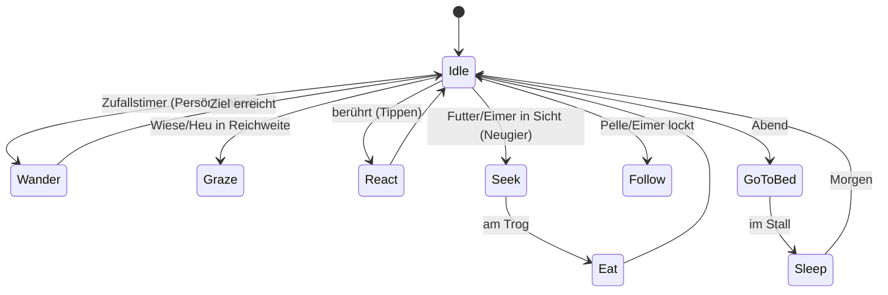

# 06 – Tiere und Stall

> Tiere sind das emotionale Herz des Spiels. Sie sind **nie krank, nie traurig, nie in Gefahr**. Sie sind neugierig, verspielt, ein bisschen eigenwillig – und sie *freuen sich* über Zuwendung.

## 1. Tierkatalog

| ID | Tier | Babys | Produkt(e) | Hofstufe | Anzahl (Stufe 1 → Vollausbau) | Ort |
|---|---|---|---|---|---|---|
| `animal.chicken` | Huhn | Küken | Eier (weiß, braun, blaugrün) | 1 | 3 → 6 | Hühnerhaus |
| `animal.cow` | Kuh | Kalb | Milch | 2 | 2 → 4 | Kuhstall |
| `animal.sheep` | Schaf | Lamm | Wolle | 3 | 3 → 6 | Schafweide |
| `animal.pig` | Schwein | Ferkel | Kompost („Gartendünger“) | 3 | 2 → 3 | Schweinekoben |
| `animal.duck` | Ente | Entlein | Eier (kleine), Federn | 4 | 3 → 5 | Ententeich |
| `animal.goat` | Ziege | Zicklein | Ziegenmilch (→ Käse) | 4 | 2 → 3 | Ziegengehege |
| `animal.horse` | Pferd | Fohlen | Kutschfahrten (keine Produkte) | 5 | 1 + Fohlen | Pferdekoppel |
| `animal.rabbit` | Kaninchen | Junge | – (Streichel-Tier) | 5 | 2 → 4 | Hasengehege (an der Pferdekoppel, `loc.paddock`) |
| `animal.cat` | Hofkatze **Minka** | – | – (autonom, Gast) | 1 | 1 | überall |
| `animal.dog` | Hofhund **Pelle** | – | – (Begleiter/Guide) | 1 | 1 | überall |
| `animal.bee` | Bienen | – | Honig | 5 | 1 Stock | Imkerei/Blumenwiese |

> **Keine Fleischprodukte.** Tiere werden nicht geschlachtet, nicht verkauft, nicht „verbraucht“. Tiere bleiben auf dem Hof und sind Freunde.
> **Nur freundliche Natur:** Kein Fuchs, der Hühner stiehlt. Ein Fuchs *darf* als scheuer, freundlicher Besucher am Waldrand vorbeikommen (Entdeckung im Hofbuch).

## 2. Persönlichkeit und Namen

Jedes Tier ist ein **Individuum** mit Name, Fellmuster, Lieblingsfutter und kleiner Eigenheit. Namen werden gesprochen (Pelle nennt sie beim Namen) und sind pro Tierart eine feste Liste (Voice-Lines vorproduziert, Dokument 13).

| Tier | Beispielnamen (Arbeitstitel) | Eigenheiten (Beispiele) |
|---|---|---|
| Huhn | Frieda, Hilde, Pippa, Klara, Emma, Gisela | Frieda liebt Körner, Pippa versteckt Eier, Klara tanzt |
| Kuh | Berta, Lotte, Flora, Wilma | Berta mag Karotten, Lotte lässt sich gern bürsten |
| Schaf | Wolli, Flocke, Wölkchen, Lena | Flocke hüpft vor Freude, Wölkchen ist schüchtern |
| Schwein | Rosi, Paula, Emil | Rosi liebt Matsch und Äpfel |
| Ente | Quaki, Paddel, Pflaume | Pflaume watschelt vor |
| Ziege | Hannes, Mia | Hannes klettert überall hinauf |
| Pferd | Sternchen | Sternchen mag Äpfel und Streicheln |
| Kaninchen | Hoppel, Fluse | Fluse versteckt sich im Gras |

**Persönlichkeits-Parameter** (steuern nur Animation/Verhalten, 0–1): `curiosity`, `playfulness`, `shyness`, `laziness`. Die Parameter sorgen für Wiedererkennbarkeit, nicht für Spielmechanik.

**Lieblingsdinge (Merkaufgabe ab Stufe Spross):** Tiere haben ein *Lieblingsfutter* (z. B. Berta → Karotte). Sobald das Kind es einmal herausgefunden hat, merkt sich das Hofbuch (Herzchen). In späteren Wünschen: „Berta hat Hunger. Was mag Berta am liebsten?“ → `cog.memory`, `cog.matching`.

## 3. Bedürfnisse – Wünsche statt Balken

Es gibt **keine Bedürfnis-Balken**, keinen Verfall, keine Strafen. Tiere haben pro Tag **Wunschblasen** („Ich hätte gern …“), die verschwinden, wenn sie erfüllt wurden. Unerfüllte Wünsche bleiben bestehen; das Tier wirkt *erwartungsvoll* (Kopf neigen, Schwanzwedeln), **nie traurig**.

| Wunsch | Symbol | Handlung | Kompetenz |
|---|---|---|---|
| Hunger | Futter-Napf | Futter zuweisen (Heu, Körner, Möhren) | `cog.matching`, `mo.drag` |
| Durst | Wassertropfen | Eimer füllen und zum Trog tragen | `mo.drag`, `cog.sequence` |
| Streicheln | Hand/Herz | Streichel-Geste über das Tier | `mo.tap`, `soc.care` |
| Bürsten | Bürste | Kreisbewegung | `mo.drag` |
| Spielen | Ball/Wolle | Gegenstand werfen/hin und her ziehen | `mo.drag` |
| Sauber werden | Schwamm | Schwein waschen, Stall ausmisten | `mo.drag` |
| Ins Bett | Mond | Tier in den Stall führen | `cog.sequence`, `math.count` |
| Besonderheit (saisonal) | z. B. Schere, Flasche | Scheren, Kalb tränken | – |

### Stimmung: nur positiv
Animationszustände: *freudig*, *zufrieden*, *erwartungsvoll*, *müde* (abends), *verspielt*. Es gibt **keinen** „traurig/krank/hungrig-leidend“-Zustand. „Unerfüllt“ wird als „erwartungsvoll“ gezeigt.

## 4. Interaktionen je Tier (Aktivitäten)

Jede Interaktion ist eine **Hofaktivität** (Dokument 09) mit Steuerung je Stufe. Hier die Kernlogik:

### 4.1 Huhn (Hühnerhaus) – Hofstufe 1

| Aktivität | Keimling | Spross | Blüte |
|---|---|---|---|
| **Füttern** | Tipp aufs Futter, Tipp aufs Huhn: Körner fliegen | Körner mit Wischbewegung „streuen“, Hühner kommen herbei | Futter portionieren (z. B. 3 Scoops für 3 Hühner), Hühner zählen |
| **Eier suchen** | Eier leuchten | Eier in Nestern/Heu (antippen/aufdecken) | Eier versteckt unter Strohhaufen/Büschen, Zielmenge nennen („Finde 5 Eier!“) |
| **Eier sortieren** | – | Nach Farbe in 2 Körbe ziehen | Nach Farbe *und* Größe in 3 Kisten; Zählen |
| **Streicheln** | Tipp | Halten+Streichen | Streichel-Reihenfolge (alle Hühner, jedes einmal) |
| **Küken (Frühling)** | Küken folgen Henne (zuschauen) | Küken in den Stall treiben (Locken mit Körnern) | Küken zählen, Henne ruft |

### 4.2 Kuh (Kuhstall) – Hofstufe 2

| Aktivität | Keimling | Spross | Blüte |
|---|---|---|---|
| **Wasser** | Tipp Pumpe, Tipp Trog (Wasser läuft automatisch) | Eimer unter Pumpe halten, tragen und in Trog kippen | 2–3 Eimer nötig, Wasserstand-Markierung füllen |
| **Füttern** | Tipp Heu, Tipp Kuh | Heu mit Heugabel (Ziehen) in Trog | Heu-Ballen mit Frontlader zum Stall fahren |
| **Bürsten** | Tipp Bürste | Kreisbewegung (3×) | Gleichmäßig die ganze Kuh bürsten (Heatmap „Sauber“) |
| **Melken** | Tipp Euter: Milch fließt in Eimer | Abwechselnd links/rechts tippen (Rhythmus) | Milchmaschine bedienen + Flaschen abfüllen (Zählen) |
| **Kalb tränken (Frühling)** | Tipp Flasche → Kalb | Flasche ziehen, halten | Flasche portionieren (Milchlevel) |

### 4.3 Schaf (Schafweide) – Hofstufe 3

| Aktivität | Keimling | Spross | Blüte |
|---|---|---|---|
| **Zählen** | Pelle zählt, Kind tippt Schaf (Highlight 1–3) | Kind tippt Schafe der Reihe nach (bis 5) | Schafe zählen (bis 10–20), Gruppen zu je 5 |
| **Hüten** | Pelle hütet automatisch | Linie in die Wiese **zeichnen**, Pelle läuft sie ab, Schafe folgen | Linie um Hindernisse ziehen (Pfadführung), alle Schafe ins Gatter |
| **Scheren (Sommer)** | Tipp Schermaschine, Schaf wird „nackig“ (lustig, aber nie peinlich) | Schere über Wolle führen | Muster nachfahren, Wolle sammeln, Wollknäuel zählen |
| **Streicheln** | Tipp | Halten | Reihum |

### 4.4 Schwein (Schweinekoben) – Hofstufe 3

| Aktivität | Keimling | Spross | Blüte |
|---|---|---|---|
| **Matschbad** | Tipp Pfütze: Schwein hüpft rein | Schwein in die Pfütze lenken | – |
| **Waschen** | Tipp Schwamm/Dusche | Kreisbewegung bis „rosa“ | Gleichmäßig waschen (Heatmap) |
| **Futter** | Tipp Küchenreste | Abfälle sortieren (Apfel/Salat → Schwein; Papier ≠) | Sortieren in 3 Kategorien (Schwein/Kompost/Huhn) |
| **Kompost** | Kompost fließt in den Garten (Animation) | Kompost zu Beeten tragen | Düngen mit Schubkarre |

### 4.5 Ente, Ziege, Pferd, Kaninchen – Kurzprofil

| Tier | Aktivität (Beispiele) |
|---|---|
| **Ente** | *Entenmarsch:* Enten in Reihe führen (Sequenz: Mama zuerst, dann Kinder, Muster/Reihenfolge); Teichboot (Lenken); Futter schnippen |
| **Ziege** | Ziege auf Klettersteine setzen (Ziehen), „Wer ist ganz oben?“ (Höhenvergleich); Käse-Wunsch → Hofküche |
| **Pferd** | Striegeln (Wischen), Hufe auskratzen (halten), **Kutschfahrt** zum Dorfmarkt (Lenken, Chase-Cam) |
| **Kaninchen** | Karotten füttern, Gehege-Labyrinth (Hasen durch Tunnel locken: Pfad ziehen), Streicheln |

### 4.6 Hofkatze Minka & Pelle
- **Minka** ist ein autonomer Gast, der nie Wünsche stellt; sie schnurrt, wenn man sie streichelt, und folgt Wollknäueln. Tippen auf Minka → Zeitlupen-Schnurren und eine kleine Überraschung (Blume, Feder).
- **Pelle** ist Guide, aber auch Spielkamerad: Stöckchen werfen (Wischen), Pelle holt und bringt (Apportieren), Pelle wird gestreichelt, Pelle schläft abends als Letzter im Hof.

## 5. Abendritual – „Alle ins Bett“

Am Ende jedes Hoftags (Phase **Abend**) führt das Kind die Tiere in ihre Ställe. Das ist natürlicher Zähl-, Merk- und Reihenfolgen-Moment:

- **Keimling:** Kind tippt aufs Stalltor; alle Tiere gehen allein hinein (Pelle: „Gute Nacht, Berta! Gute Nacht, Lotte!“). Nach dem Schließen *drei Sterne* am Dach.
- **Spross:** Kind lockt die Tiere mit einem Futtereimer, **zählt** sie rein („Eins, zwei, drei – alle da!“).
- **Blüte:** Mehrere Ställe; Kind merkt sich, wer noch draußen ist (Pelle fragt „Fehlt noch jemand?“ – das Spiel unterstützt durch leises Mähen/Gackern hörbar auf Tippen, kein Verstecken bei Nacht).
- Kein Tier kann „draußen vergessen“ werden: Bleibt eines draußen, geht es nach 20 s allein und leise in den Stall (kein „Fehler“).

## 6. Babys und Jahreszeiten

| Saison | Tier-Ereignisse |
|---|---|
| **Frühling** | Küken schlüpfen, Lämmer, Kälbchen, Entlein (Überraschungen am Morgen: „Schau mal, wer da ist!“) |
| **Sommer** | Schafe scheren, Planschen im Teich, Wiese: Tiere liegen im Schatten, Wasser wichtiger |
| **Herbst** | Tiere bekommen Fallobst, Heu einlagern, Ziegenkäse, Küken wachsen zu Hühnern |
| **Winter** | Stallzeit: Tiere „kuscheln“, Vogelhäuschen, Futter bringen, Schneespuren, Mützen für Schafe (Wolle) |

Babys wachsen im **Hofbuch-Rhythmus**: Nach einem Hoftag-Jahr werden aus Babys erwachsene Tiere (neues Modell); Kindern wird das gezeigt, aber nie negativ (kein „Wo ist das Baby hin?“, sondern „Schau, Pippa ist groß geworden!“).

## 7. Tier-Reaktionen & Berührungen

- **Jedes Tier reagiert auf Berührung** (Ohr zuckt, Schwanz wedelt, kleines Geräusch). Daueranstupsen führt zu *Gewöhnung* (Reaktion wird sanfter), nie zu Genervtheit.
- **Streicheln:** Halten + leichte Bewegung → Tier schließt Augen, Herzchen, Schnurr-/Zufriedenheitsgeräusch (SFX-Layer), Haptik auf iPhone (sanftes Pulsieren).
- **Folgen:** Wenn das Kind einen Futtereimer zieht, folgen Tiere dem Eimer (Neugier). Das ist eine reine Leit-Mechanik.
- **Tiersprache:** Tiere sprechen nicht in Worten. **Pelle übersetzt** („Berta sagt Muh! Sie hat Hunger!“). Echte Tiergeräusche (SFX) laufen immer *vor* der Übersetzung.

## 8. Tier-Verhalten (KI, vereinfacht)

Zustandsautomat je Tier (läuft als RealityKit-System, Dokument 15):

- Navigation über das Kachelraster (A*, vorberechnete Wegepunkte), **lokale Vermeidung** (Separation), keine Physik-Kollisionen zwischen Tieren (Performance, Stabilität).
- Max. **40 Tiere** gleichzeitig aktiv; Tiere außerhalb des Bildbereichs laufen im „Light“-Modus (nur Zustandstimer, keine Animation).

## 9. Hofbuch-Eintrag je Tier

Jeder Eintrag besteht aus: Bild (3D-Rendering), Name, Babyname, Tiergeräusch (SFX), 1 Satz Wissen (gesprochen von Pelle), Liste „mag gern“ (Piktogramme), Produkt (falls vorhanden).

Beispiel Kuh – gesprochen von Pelle:
> „Das ist die Kuh. Die Kuh sagt Muh. Das Kälbchen heißt Kalb. Die Kuh gibt uns Milch.“

(Siehe Content-Katalog, Dokument 21, für alle Einträge.)

## 10. Produkte & Verwertung

| Tier | Rohprodukt | Verarbeitung (Hofküche) | Endprodukt | Laden-Item |
|---|---|---|---|---|
| Huhn/Ente | Ei | Backofen (mit Mehl) | Kuchen | `item.cake` |
| Kuh | Milch | Butterfass | Butter | `item.butter` |
| Kuh | Milch | Käserei (Ziegenmilch/Kuhmilch) | Käse | `item.cheese` |
| Schaf | Wolle | Wollspinnerei/Strickstube (Stufe 5) | Mütze/Schal | `item.beanie` |
| Ziege | Milch | Käserei | Ziegenkäse | `item.goatcheese` |
| Biene | Honig | Honigschleuder | Honigglas | `item.honey` |
| Schwein | Kompost | – (Gartendünger) | Dünger (Garten) | – |

(Details und Verkaufspreise: Dokument 07.)
