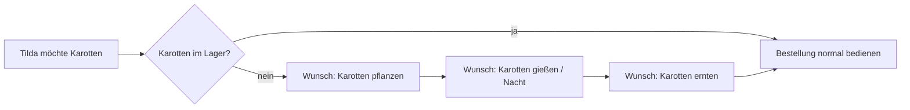

# 07 – Hofladen, Wirtschaft und Hofküche

> Wirtschaft in MiniFarm bedeutet: **Dinge schenken, tauschen, Freude machen** – nie Gewinn maximieren. Es gibt keine Knappheit, keine Schulden, keinen Preisdruck. Zahlen erscheinen nur als Punkte/Bilder, später optional als Ziffern.

## 1. Der Hofladen

### 1.1 Ausbaustufen

| Stufe | Form | Regal-Plätze | Besonderheiten |
|---|---|---|---|
| Hofstufe 1 | **Verkaufsstand** (Holzkarren mit Markise) | 6 | Ein Kunde gleichzeitig |
| Hofstufe 3 | **Hofladen-Häuschen** | 12 | Tresen, Waage, Kasse, Schaufenster; 2 Kunden gleichzeitig |
| Hofstufe 5 | + **Dorfmarkt-Stand** | +8 (Markt) | Ausflug mit Traktor + Anhänger |

### 1.2 Das Regal befüllen
- Das Regal hat **Plätze mit Silhouetten** (z. B. Korb für Äpfel, Kiste für Möhren, Flasche für Milch). Silhouette = zugeordneter Item-Typ → Sortier-/Zuordnungsaufgabe (`cog.matching`).
- Das Kind zieht Items aus dem **Lager** (Kisten rechts neben dem Laden) auf passende Plätze (Keimling: Tippen aufs Item → fliegt automatisch).
- Ein Regalplatz zeigt **Mengenpunkte** (1–5 Punkte); die Punkte füllen sich mit jedem Item (Zählen).
- Das Regal hat **keinen Verfall** – Items bleiben liegen, bis Kunden sie nehmen. Das Lager füllt das Regal *auch ohne Zutun* auf (Wünsche erzeugen Anlass, nicht Zwang).
- **Freies Arrangieren:** Kinder dürfen Items beliebig platzieren (Rollenspiel „Laden“); das Spiel bewertet nichts.

### 1.3 Kunden

| Kunde | Art | Vorlieben (Beispiele) | Hofstufe |
|---|---|---|---|
| **Tilda** (Bäckerin) | Dorfbewohnerin | Mehl, Eier, Äpfel | 1 |
| **Opa Hanno** | Dorfbewohner, Opa | Kartoffeln, Karotten, Wolle (für Socken) | 2 |
| **Mo** | Nachbarskind | Erdbeeren, Eis, Kuchen | 3 |
| **Lale** (Postbotin) | Dorfbewohnerin | Apfelsaft, Brot | 4 |
| **Yusuf** (Markthändler) | Dorfbewohner | Mais, Honig, Käse | 4 |
| **Tierbesucher** | Igel, Eichhörnchen, Vögel | Nüsse, Körner (Tauschen, nicht Verkaufen) | 3 |

(Namen und Rollen sind Arbeitstitel; Diversität in Aussehen, Alter, Stimme bewusst gestalten – ohne Klischees.)

**Kunden-Verhalten:**
- Kunden warten **unbegrenzt** (Idle-Animationen: pfeifen, Blumen riechen, Tiere streicheln).
- Kunden sind **immer freundlich**. Sie sagen nie „zu teuer“, „zu langsam“, „falsch“.
- Wiederkehrende Gesichter: Stammkunden entwickeln über Zeit kleine **Geschichten** (Mo zeigt eine Zeichnung, Tilda bringt ein Brot, Hanno schnitzt ein Tier – als Deko-Geschenke fürs Hofbuch).

### 1.4 Bestellung (Order)

Eine Bestellung erscheint als **Bestell-Blase** mit Bildern und Mengenpunkten (z. B. 🍎🍎 + 🥛). Gesprochen von Pelle und dem Kunden:

> Tilda: „Hallo! Ich hätte gern zwei Äpfel und eine Milch.“ (dazu Blase)

| Parameter | Keimling | Spross | Blüte |
|---|---|---|---|
| Item-Typen je Bestellung | 1 | 1–2 | 2–3 |
| Menge je Typ | 1–2 | 1–3 | 1–5 |
| Gesamtzahl Items | 1–2 | 2–5 | 3–10 |
| Bestell-Blase | immer sichtbar | immer sichtbar | **Merk-Modus** (verschwindet nach 3 s, Tipp zeigt sie erneut) *(Kind kann in Eltern-Einstellungen aus)* |
| Gleichzeitige Kunden | 1 | 1–2 | 2–3 |
| Preis-Anzeige | Münz-Symbole | Münzen + Ziffern | Ziffern + Münzen |

#### Ablauf einer Bestellung
1. Kunde kommt (Gehen-Animation, Begrüßung).
2. Bestell-Blase erscheint; Pelle wiederholt die Bestellung langsam.
3. Ein **Korb** (Tablett) erscheint am Tresen; Silhouetten der Items sind angedeutet (Keimling/Spross).
4. Kind zieht Items aus dem Regal in den Korb (Snap).
   - *Richtiges Item:* Korb schluckt es, Punkt leuchtet, Pelle zählt.
   - *Falsches Item:* Korb wackelt freundlich, Item hüpft zurück; Pelle benennt es („Das ist eine Birne. Hier brauchen wir einen Apfel!“ → Wortschatz).
5. Wenn der Korb voll ist (alle Mengenpunkte leuchten): **Klingel** (großer Glocken-Button, Keimling: automatisch).
6. Kunde bedankt sich, **zahlt Taler** (Münzen klimpern in die Kasse), Pelle lobt konkret („Zwei Äpfel und eine Milch – genau richtig!“).
7. Optional (Blüte): Das Kind zählt die Münzen („Wie viele Taler sind das?“ – ohne Verpflichtung).

### 1.5 Wunschketten (Stock-sicheres Auftragssystem)

**Bestellungen werden nur aus Items erzeugt, die im Lager vorhanden sind.** Ist das Lager (noch) leer für den Wunsch, erzeugt das Spiel eine **Wunschkette**:

Pelle erklärt: „Tilda hätte gern Karotten. Wir haben noch keine. Wollen wir welche pflanzen?“ So entstehen Produktionsketten **aus dem Spielfluss**, nicht aus einem Menü.

## 2. Taler (Währung ohne Druck)

| Eigenschaft | Festlegung |
|---|---|
| Name | **Taler** (Goldmünze mit Kleeblatt) |
| Verdienst | Pro Bestellung 2–15 Taler (je nach Items); pro Tag ca. 15–60 |
| Sichtbarkeit | Münzstapel am Kassenhaus + im Rucksack (Keimling: nur Haufen; Spross: Punkte; Blüte: Ziffer) |
| Verwendung | **Nur kosmetisch/kreativ** (Deko, Tier-Accessoires, Traktor-Sticker, Hofschilder, Musikspieluhren) |
| **Nie nötig** für Fortschritt | Hofstufen, neue Orte, Tiere, Maschinen, Saatgut schalten *durch Spielen* frei, **nicht** durch Taler |
| Obergrenze | Keine (aber keine große Zahl wird angezeigt; ab 100 nur „viele“-Symbol bei Keimling/Spross) |
| Verlust | Nie. Es gibt keine Steuern, Kosten, Diebstahl, Schulden |

### 2.1 Kaufen ohne „Nein“ (Wunschzettel)

Wenn das Kind etwas Kosmetisches kaufen will (im **Hofdeko-Schaufenster** am Hofplatz):

1. Tippen auf Item → Pelle: „Das kostet *fünf* Taler.“ (Münz-Icons/Punkte)
2. Hat das Kind genug Taler: Kind **zieht Münzen** ins Schaufenster (oder tippt „Ja!“) → Item erscheint (Lale liefert das Paket).
3. Hat das Kind **nicht** genug: Das Item geht auf den **Wunschzettel** („Das legen wir auf deinen Wunschzettel. Sobald wir genug Taler haben, bringt Lale es vorbei!“). Es wird **automatisch geliefert**, sobald genug vorhanden sind – ohne weitere Aktion. Es gibt kein „zu wenig Geld“-Gefühl.
4. **Schutz vor Frust:** Das Spiel hält Preise so niedrig, dass das Kind in ≤ 1 Hoftag etwas bekommt (Preisbänder: 3–10 Taler; „große Wünsche“: 15–30 Taler, erst in Hofstufe ≥ 3).

> **Kein echtes Geld, keine IAP im Spiel.** Taler sind eine reine Spielwährung und nicht kaufbar.

## 3. Die Hofküche (Verarbeitung) – Hofstufe 4

Die Hofküche verwandelt Rohstoffe in Produkte. Jede Verarbeitung ist eine **kurze Handlungsfolge in Bildern** (Rezeptkarte mit 3–5 Piktogrammen) → Training für `cog.sequence`.

### 3.1 Geräte und Rezepte

| Gerät | Input | Output | Handlung (Blüte) | Keimling-Variante |
|---|---|---|---|---|
| **Mühle** | Weizen (3 Garben) | Mehl | Kurbel im Kreis drehen (2×), Korn einfüllen | Tipp aufs Rad, Mehl rieselt |
| **Backofen** | Mehl + Wasser | **Brot** | Teig kneten (Wischen), Form wählen, Ofen schieben, Ofen-„Ding“ abwarten, herausnehmen | Tipp Teig → Tipp Ofen → Tipp Brot |
| **Backofen** | Mehl + Ei + Milch (+ Erdbeere) | **Kuchen** | wie oben + Zutaten in der Reihenfolge der Rezeptkarte | vereinfacht (2 Zutaten) |
| **Saftpresse** | Äpfel (3–6) | **Apfelsaft** | Äpfel zählen, Hebel nach unten ziehen, Flaschen halten | Tipp Äpfel → Saft fließt |
| **Butterfass** | Milch | **Butter** | Rhythmisch stampfen (Tipp-Tipp), Pelle klatscht | Tipp bis voll |
| **Marmeladenkessel** | Erdbeeren (4) | **Marmelade** | Mit großem Löffel in Kreisen rühren | Tipp Löffel |
| **Eismaschine** (Sommer) | Milch + Erdbeere | **Erdbeereis** | Kurbel drehen | Tipp |
| **Käserei** | Milch | **Käse** | Milch einfüllen, Form pressen, ruhen lassen (Zeitraffer) | Tipp |
| **Honigschleuder** (steht am Bienenstock, Hofstufe 5) | Honigwaben | **Honig** | Kurbel drehen | Tipp |

**Regeln:**
- Nie verbrennt etwas, nie läuft etwas über. Der Backofen „dingt“ gemütlich, auch wenn man es vergisst; die Zeit läuft nicht *gegen* das Kind.
- Produktionszeiten sind **zeitraffernd** (ein 3-Sekunden-Schnitt), nie Echtzeit.
- Rezeptkarten sind **Bildfolgen** (z. B. Mehl → Wasser → Hände → Ofen → Brot). Pelle spricht jeden Schritt, die Karte hakt mit einem Haken (grüner Kreis ✓ nur positiv, nie rotes X) ab.

### 3.2 Produktkatalog (Auszug)

| Item-ID | Name | Quelle | Verkaufswert (Taler) | Hofstufe |
|---|---|---|---|---|
| `item.flour` | Mehl | Mühle | 2 | 4 |
| `item.bread` | Brot | Backofen | 4 | 4 |
| `item.cake` | Kuchen | Backofen | 6 | 4 |
| `item.applejuice` | Apfelsaft | Saftpresse | 4 | 4 |
| `item.butter` | Butter | Butterfass | 3 | 4 |
| `item.cheese` | Käse | Käserei | 5 | 4 |
| `item.jam` | Marmelade | Kessel | 4 | 4 |
| `item.icecream` | Erdbeereis | Eismaschine | 5 | 4 |
| `item.honey` | Honigglas | Schleuder | 5 | 5 |
| `item.goatcheese` | Ziegenkäse | Käserei (Ziegenmilch) | 6 | 4 |
| `item.beanie` | Mütze | Strickstube (Anbau der Hofküche, Wolle → Mütze) | 6 | 5 |

Rohprodukte: Ei, Milch, Wolle, Honig und Ernte-Items (siehe Dokumente 05/06) werden direkt in den Hofladen gegeben (Wert 1–4 Taler).

## 4. Dorfmarkt (Ausflug) – Hofstufe 5

Der Dorfmarkt ist ein **optionaler Ausflug** auf einer eigenen kleinen Karte (Straße, Marktplatz, 4 Stände).

**Ablauf:**
1. **Beladen:** Das Kind wählt aus dem Lager bis zu 3 (Keimling: 1) Produkte (Merkaufgabe: eine kleine Liste zeigt Symbole; Blüte: Liste verschwindet kurz).
2. **Fahrt:** Traktor/Pferdekutsche mit Anhänger fährt über die Landstraße (Chase-Cam, Auto-Lenkung bei Keimling). Unterwegs: Tiere am Zaun, Wind, Dorfbewohner winken (Entdeckungen).
3. **Aufbau:** Kind stellt die Waren auf den Markttisch (Muster nachlegen, z. B. rot–gelb–rot; `perc.shape`).
4. **Verkauf:** Marktkunden wie im Hofladen (kleinere Bestellungen).
5. **Heimfahrt:** Ein Geschenk vom Markt (neue Deko/Saatgut).

## 5. Hofladen-Deko & Personalisierung (Kreativität)

| Bereich | Beispiele | Wo erhältlich |
|---|---|---|
| Ladenschild | Bilder statt Text (Apfel, Brot, Kuh) | Wunschzettel/Hofdeko-Schaufenster |
| Markisenfarben | 6 Farben + Muster (Streifen, Punkte) | Hofdeko |
| Blumenkästen | Jahreszeit-Blumen | Hofdeko |
| Tafel | Piktogramm-„Angebote“ (Kind wählt 3 Bilder) | frei |
| Hofdeko allgemein | Zäune, Bänke, Laternen, Wimpelketten, Vogelhäuschen, Windräder | Hofdeko |
| Tier-Accessoires | Schleifen, Glöckchen, Hüte | Hofdeko |
| Traktor-Sticker | Stern, Blume, Herz, Regenbogen | Hofdeko |

## 6. Wirtschafts-Parameter (Startwerte, tunebar in `economy.json`)

| Parameter | Wert |
|---|---|
| Ø Verdienst je Bestellung (Keimling/Spross/Blüte) | 3 / 6 / 10 Taler |
| Bestellungen je Hoftag | 2 / 3 / 4 |
| Tagesverdienst (Ø) | 6 / 18 / 40 Taler |
| Preise Deko | 3–10 (klein) · 15–30 (groß) |
| Ziel: erste kosmetische Belohnung | spätestens nach Hoftag 1 |

> Diese Werte sind absichtlich großzügig; die Wirtschaft ist ein **Spielzeug**, kein System, das Entscheidungen erzwingt.
