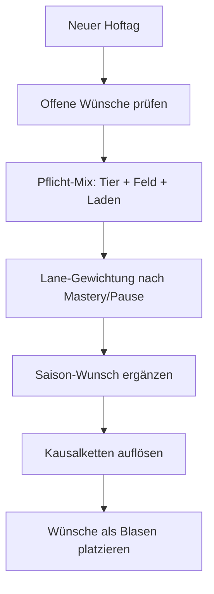

# 09 – Wünsche und Teilaufgaben (Aktivitätenkatalog)

> Alle Aufgaben im Spiel sind **Wünsche von Tieren, Menschen oder Pflanzen** und finden an ihrem natürlichen Ort statt. Es gibt keine „Minispiele“ in separaten Menüs. Jede Aktivität ist eine kleine, abgeschlossene Handlungsfolge (30–120 Sekunden), die Kernkompetenzen trainiert, ohne dass sie wie eine Übung wirkt.

## 1. Integrationsregeln (diegetisch statt aufgesetzt)

| Regel | Bedeutung |
|---|---|
| **R1 – Ort-Logik** | Jede Aktivität gehört zu einem Ort (Feld, Stall, Laden, Küche, Teich …) und wird dort durchgeführt. |
| **R2 – Bedürfnis statt Aufgabe** | Auslöser ist immer eine Figur mit Wunsch („Rosa hätte gern Heu“), nie ein Menüpunkt „Level 3“. |
| **R3 – Werkzeug ist Spielzeug** | Werkzeuge/Maschinen sind erlebbare Objekte (Wasserkanne, Traktor), keine Symbole. |
| **R4 – Ergebnis sichtbar** | Das Ergebnis verändert die Welt dauerhaft (Beet wächst, Tier ist zufrieden, Regal gefüllt). |
| **R5 – Immer abschließbar** | Jede Aktivität hat die Scaffold-Leiter (Doc 10) bis zur gemeinsamen Erledigung; sie endet immer in „geschafft“. |
| **R6 – Keine Erzählung ohne Handlung** | Pelle erklärt höchstens 1–2 kurze Sätze, dann geht es sofort ums Tun. |
| **R7 – Kompetenzen verborgen** | Kompetenz-Lanes (Doc 02) sind nur im System, nie im UI sichtbar. |
| **R8 – Unterbrechbar** | Jede Aktivität lässt sich jederzeit verlassen (Zustand bleibt erhalten, keine Strafe). |
| **R9 – Freie Wahl** | Aus mehreren Wunsch-Blasen wählt das Kind selbst; es gibt keine Pflichtreihenfolge. |
| **R10 – Wiederholbar** | Kinder lieben Wiederholung: Jede Aktivität kann jederzeit erneut gestartet werden (als „Freies Spiel“). |

## 2. Aktivitäten-Katalog

Spalten: **ID** · **Ort** · **Kernschritte** · **Lanes** · **Hofstufe**. Parameter je Stage siehe §3.

### 2.1 Feld & Maschinen

| ID | Aktivität | Ort | Kernschritte | Lanes | Hofstufe |
|---|---|---|---|---|---|
| `act.field.plow` | Feld pflügen | Feld | Traktor fahren, Pflug absenken, Spur ziehen | `mo.steer`, `mo.drag` | 2 |
| `act.field.sow` | Aussäen | Feld | Saatgut wählen (Samentüte), Sämaschine fahren oder Hand-Säen | `cog.matching`, `mo.drag` | 1 |
| `act.field.water` | Gießen | Feld | Kanne füllen, Beete gießen / Wassertank fahren | `mo.drag`, `mo.tap` | 1 |
| `act.field.harvest` | Ernten (Hand) | Feld | Reife Pflanzen antippen/ziehen, Korb füllen | `mo.tap`, `math.count` | 1 |
| `act.field.combine` | Mähdrescher fahren | Feld | In Bahnen fahren, Korn in Hänger | `mo.steer` | 4 |
| `act.field.hay` | Heu machen | Wiese | Mähen → Wenden → Ballenpresse → Ballen laden | `cog.sequence` | 4 |
| `act.field.scarecrow` | Vogelscheuche bauen | Feld | Teile (Hut, Kopf, Körper, Arme) in richtiger Position | `perc.shape`, `cog.matching` | 2 |
| `act.field.snowplow` | Schnee schieben | Hof | Pflug fahren, Weg freimachen | `mo.steer` | 5 |

### 2.2 Tiere & Stall

| ID | Aktivität | Ort | Kernschritte | Lanes | Hofstufe |
|---|---|---|---|---|---|
| `act.animal.feed` | Tiere füttern | Stall/Wiese | Passendes Futter wählen, in Trog legen | `cog.matching`, `lang.vocab` | 1 |
| `act.animal.water` | Tränke füllen | Stall | Eimer ziehen, Trog füllen | `mo.drag` | 1 |
| `act.animal.pet` | Streicheln & Bürsten | Stall | Streichelgeste, Bürste im Kreis | `mo.drag`, `soc.care` | 1 |
| `act.animal.milk` | Kuh melken | Stall | Eimer positionieren, rhythmisch drücken | `mo.tap` | 2 |
| `act.animal.eggs` | Eier sammeln | Hühnerhof | Eier suchen (Versteck), zählen | `math.count`, `perc.shape` | 1 |
| `act.animal.shear` | Schaf scheren | Wiese | Schere führen, Wolle sammeln | `mo.drag` | 3 |
| `act.animal.bed` | Alle ins Bett | Stall | Tiere zu Schlafplatz führen (Heu), zudecken | `cog.matching`, `soc.care` | 1 |
| `act.animal.find` | Tier-Suchspiel | Hof | „Wo ist das Lamm?“ Hinweis-Geräusche folgen | `perc.shape`, `cog.memory` | 2 |
| `act.animal.baby` | Baby-Tier pflegen | Stall | Wärmen, füttern, Namen vergeben (Bildwahl) | `soc.care` | 3 |

### 2.3 Laden & Küche

| ID | Aktivität | Ort | Kernschritte | Lanes | Hofstufe |
|---|---|---|---|---|---|
| `act.shop.stock` | Regal befüllen | Laden | Items auf Silhouetten ziehen | `cog.matching`, `math.count` | 1 |
| `act.shop.order` | Bestellung erfüllen | Laden | Blase verstehen, Korb füllen, Klingel | `cog.memory`, `math.count` | 1 |
| `act.shop.sign` | Ladenschild gestalten | Laden | 3 Bilder wählen und anordnen | `cog.sequence`, `perc.shape` | 3 |
| `act.shop.market` | Marktausflug | Markt | Beladen, fahren, aufbauen, verkaufen | `cog.memory`, `mo.steer` | 5 |
| `act.kitchen.bake` | Backen | Küche | Rezeptkarte Schritt für Schritt | `cog.sequence` | 4 |
| `act.kitchen.press` | Saft pressen | Küche | Äpfel zählen, Hebel, Flaschen | `math.count`, `mo.drag` | 4 |
| `act.kitchen.churn` | Butter rühren | Küche | Rhythmus tippen | `mo.tap` | 4 |
| `act.kitchen.jam` | Marmelade kochen | Küche | Rühren, Gläser füllen | `mo.drag` | 4 |

### 2.4 Natur, Garten & Entdecken

| ID | Aktivität | Ort | Kernschritte | Lanes | Hofstufe |
|---|---|---|---|---|---|
| `act.nature.flowers` | Blumen pflücken | Wiese | Nach Farbe/Anzahl pflücken | `math.count`, `perc.shape` | 1 |
| `act.nature.pond` | Teich-Besuch | Teich | Frösche zählen, Fische füttern | `math.count` | 2 |
| `act.nature.birdhouse` | Futterhäuschen füllen | Garten | Körner einfüllen, Vögel beobachten, benennen | `lang.vocab` | 2 |
| `act.nature.compost` | Kompost/Wurm-Suche | Garten | Würmer finden, zum Beet bringen | `world.time` | 3 |
| `act.nature.kite` | Drachen steigen lassen | Wiese | Ziehen & Ablassen, Muster in der Luft | `mo.drag` | 3 |
| `act.nature.snowman` | Schneemann bauen | Hof | Kugeln rollen, Größen ordnen, Gesicht wählen | `perc.shape`, `cog.sequence` | 3 |
| `act.nature.lantern` | Laternen aufstellen | Hof | Muster wiederholen (2-3 Farben) | `cog.sequence` | 3 |

### 2.5 Hofleben & Dorf

| ID | Aktivität | Ort | Kernschritte | Lanes | Hofstufe |
|---|---|---|---|---|---|
| `act.village.mail` | Post austragen | Dorf | Briefe nach Bild-Adresse zuordnen | `cog.matching`, `cog.memory` | 4 |
| `act.village.helpmo` | Mo hilft (Nachbarskind) | Hof | Spielzeug suchen, Zeichnung ergänzen | `soc.care`, `perc.shape` | 3 |
| `act.farm.decorate` | Hof gestalten | Hof | Deko platzieren (Freies Spiel) | – | 2 |
| `act.farm.photo` | Hoffoto | Hof | Tiere zum Gruppenbild versammeln | `soc.care` | 2 |
| `act.farm.clean` | Aufräumen | Hof | Gegenstände in Kisten sortieren | `cog.matching` | 1 |
| `act.farm.memory` | Memory-Wunsch | Scheune | Bildpaare an Holzbrettern aufdecken | `cog.memory` | 3 |
| `act.farm.sing` | Pelles Lied | Hof | Tierlaute in Reihenfolge nachspielen | `cog.sequence`, `lang.vocab` | 2 |

**Summe:** 39 Aktivitäten, davon 21 ab Hofstufe 1–2 (MVP-Kern). Verteilung nach Hofstufe: 1 → 12 · 2 → 9 · 3 → 9 · 4 → 7 · 5 → 2. Das Content-Verzeichnis (Doc 21) führt die vollständige Liste mit Voice-Line-Kategorien.

## 3. Parameter je GrowthStage (Beispiele)

| Aktivität | Keimling | Spross | Blüte |
|---|---|---|---|
| `act.shop.order` | 1 Item, Blase dauerhaft | 2 Items, Blase dauerhaft | 3–5 Items, Merk-Modus |
| `act.animal.feed` | 1 richtiges Futter (andere ausgegraut) | 2–3 Auswahl | 4–6 Auswahl, mehrere Tiere |
| `act.field.sow` | Tippen aufs Beet, Samen fliegen | Ziehen entlang Reihe | Maschine lenken, Reihen planen |
| `act.nature.lantern` | Muster aus 2 Elementen, Wiederholung 2× | 3 Elemente | 3 Farben, Muster-Variationen |
| `act.field.harvest` | Alle Pflanzen reif; Tippen | Reife von unreifen unterscheiden | Maschine/gezielte Ernte, Zählen |
| `act.farm.memory` | 3 Paare, Aufdecken bleibt offen | 4–6 Paare | 8 Paare |

Alle Zahlen sind in `activities.json` ablegbar (Doc 16) und werden vom Adaptiv-System (Doc 10) fein skaliert.

## 4. Anatomie einer Aktivität (Vorlage)

```yaml
id: act.animal.feed
location: loc.cowbarn
trigger: wish.animal.hungry       # Wunsch der Figur
participants: [animal.cow, item.hay]
steps:
  - id: choose_food       # Kind wählt das richtige Futter
    lane: cog.matching
    voice_pre: vl.pelle.feed.choose
  - id: deliver           # Futter ins Trog ziehen
    lane: mo.drag
    voice_pre: vl.pelle.feed.deliver
completion:
  world_change: animal.mood=happy
  reward: [vl.pelle.praise.feed, hofbook.entry?]
scaffold: [cue, voice_hint, ghost_hand, together]
params: { keimling: {...}, spross: {...}, bluete: {...} }
```

## 5. Wunsch-Generator

Der Generator wählt täglich eine **Wunsch-Menge** (4/5/6 je Stage, siehe Doc 03) mit folgenden Regeln:

1. **Pflicht-Mix:** Mindestens 1 Tierwunsch, 1 Feldwunsch, 1 Ladenwunsch pro Hoftag.
2. **Kein Wiederholen am selben Ort direkt hintereinander** (Ortswechsel erzeugt Abwechslung).
3. **Kompetenz-Balance:** Wähle bevorzugt Lanes, die lange nicht geübt wurden (Gewicht ∝ Tage seit letztem Training), aber *nie* Lanes mit `mastery < 0.2` (Frustgefahr) ohne Scaffold.
4. **Saison-Bonus:** 1 Wunsch passend zur Jahreszeit (Doc 08).
5. **Kausalketten** (Doc 07 §1.5): Fehlende Items erzeugen Vorläufer-Wünsche („erst pflanzen, dann ernten“).
6. **Abwechslung:** Pro Tag ≥ 3 verschiedene Lanes, ≥ 1 bewegungsarme Aufgabe (ruhig) und ≥ 1 aktivere.
7. **Wunsch bleibt bestehen**, bis erledigt (keine Verfallszeit). Max. 8 offene Wünsche gleichzeitig; ältere werden eingeklappt (Pelle erinnert freundlich).
8. **Wunsch-Rotation:** Gleiche Aktivität (Kind liebt Traktor) darf als *Freies Spiel* unbegrenzt gespielt werden, zählt aber nur 1× pro Tag für die Hofbaum-Fortschrittsschwelle.



## 6. Bildsprache der Wunsch-Blasen

- **Zwei Bilder:** *Wer* (Gesichts-Portrait) + *Was* (Gegenstand/Aktion).
- **Aktions-Piktogramme** (konsistentes Set): Hand-Tippen, Ziehen, Gießkanne, Korb, Herz (Streicheln), Zahnrad (Maschine).
- **Farbcode:** Tiere = warmes Gelb, Feld = Grün, Laden = Rot-Orange, Küche = Braun, Natur = Blau.
- **Pulsierend**, nicht blinkend (keine Hektik), mit einem sanften Klang beim Auftauchen.
- Pelle spricht den Wunsch beim Antippen **immer** aus (Voice-First).

## 7. Erfolgs-Kriterien (QA)

- Jede Aktivität ist von **mindestens 3 Kindern jeder Stage** in Playtests ohne Hilfe der Eltern abschließbar (Doc 20).
- Keine Aktivität dauert mehr als 3 Minuten bei Keimling (Aufmerksamkeitsspanne).
- Jede Aktivität hat ≥ 3 Pelle-Varianten pro Schritt (siehe Doc 12/13).
