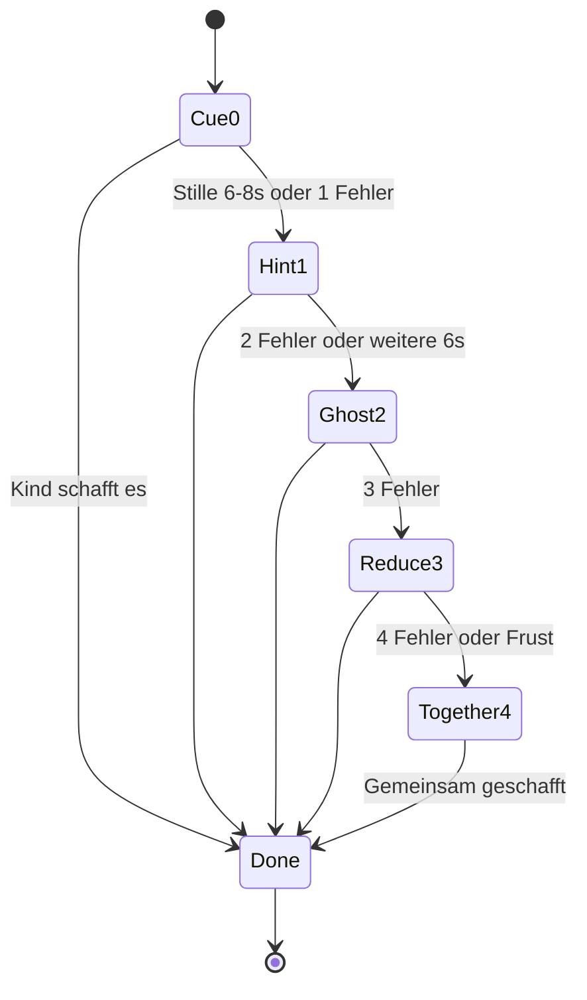

# 10 – Adaptive Unterstützung („man kann nichts falsch machen“)

> Das Spiel erkennt, wenn ein Kind Schwierigkeiten hat, und hilft **still, früh und ohne Bloßstellung**. Das Kind soll nie merken, dass es „zu schwer“ war – nur, dass es zusammen mit Pelle etwas geschafft hat. Alle Daten bleiben lokal (Doc 17).

## 1. Zielbild

1. **Erfolgsrate ~85–90 %** (unabhängig oder mit leichtem Hinweis): Aufgaben sind meist „knapp machbar“ (Zone der nächsten Entwicklung).
2. **Null Misserfolg:** Eine Aufgabe endet *immer* erfolgreich. Wenn das Kind es nicht allein schafft, schaffen sie es **gemeinsam**.
3. **Unsichtbar:** Keine Punkte, Levels, Noten, „Schwierigkeit“-Wörter im Kinder-UI.
4. **Mitwachsend:** Parameter verschieben sich über Wochen sanft; nie sprunghaft.
5. **Sanft abwärts, mutig aufwärts:** Erleichterungen sofort; Erschwerungen verzögert und in kleinen Schritten.

## 2. Datenmodell (pro Profil, lokal)

```swift
struct ProfileSkills {
    var stage: GrowthStage                  // sprout / shoot / bloom (Startwert + Fortschritt)
    var mastery: [Lane: Float]              // 0.0 ... 1.0 je Kompetenz-Lane
    var confidence: [Lane: Float]           // Sicherheit der Schätzung (Anzahl Beobachtungen)
    var recentOutcomes: [Outcome]           // Ringpuffer der letzten ~20 Aufgaben
    var fatigueScore: Float                 // Tagesform / Sitzungsdauer
}
enum Lane: String { case moTap, moDrag, moSteer, cogMemory, cogSequence,
                    cogMatching, mathCount, percShape, langVocab, worldTime }
```

`soc.care` wird **nicht gemessen** (Fürsorge ist eine Haltung, keine Fertigkeit).

## 3. Signale (lokal, nur zur Spielanpassung)

| Signal | Messung | Interpretation |
|---|---|---|
| **Zeit bis erste Aktion** | Sekunden nach Aufgabenstart ohne Eingabe | > 8 s: Orientierungslosigkeit |
| **Fehlversuche** | Falsche Auswahl/Platzierung | ≥ 2 in Folge: Hilfe nötig |
| **Tipp-Hämmern** | > 6 Taps/2 s auf gleiche Stelle | Frust/Ungeduld/Entdeckungsdrang |
| **Abbruch-Geste** | Home/Wegtippen während Aufgabe | Überforderung oder Unlust |
| **Geschwindigkeit** | Dauer relativ zur Erwartung | Sehr schnell → unterfordert |
| **Genauigkeit (Motorik)** | Abstand zur Soll-Linie/-Zone | Steuerfähigkeit (`mo.*`) |
| **Wiederholte Hilfe-Nutzung** | Pelle-Button-Taps | Unsicherheit, aber *positiv* (aktive Hilfesuche) |
| **Sitzungsdauer / Tageszeit** | Wall-Clock | Ermüdung |
| **Vorschlags-Ablehnung** | Wunsch ignoriert > 3× | Thema uninteressant |

**Nicht erhoben:** Mikrofonaufnahmen, Kamera, Gesichtsdaten, Standort, Geräte-IDs.

## 4. Scaffold-Leiter (Hilfe-Stufen)

| Stufe | Name | Auslöser | Maßnahme | Beispiel |
|---|---|---|---|---|
| **0** | Cue | Start der Aufgabe | Zielobjekt pulsiert/leuchtet sanft | Der richtige Samen glimmt |
| **1** | Verbaler Hinweis | Keine Aktion 6–8 s oder 1 Fehlversuch | Pelle: kurzer Hinweis, positiv | „Schau mal, die Karotte mag Erde!“ |
| **2** | Ghost-Hand | 2 Fehlversuche / weitere 6 s Stille | Transparente Hand zeigt die Aktion (Geste) | Ghost-Hand zieht Samen zum Beet |
| **3** | Reduktion | 3 Fehlversuche | Aufgabe vereinfachen: falsche Optionen verschwinden, Ziel vergrößert, Magnet stärker | Nur noch 2 Samentüten |
| **4** | Gemeinsam | 4 Fehlversuche / Frust-Signal | Pelle/Maschine **übernimmt** mit dem Kind („Wir machen das zusammen!“), Kind darf „mit antippen“ | Auto-Complete; Pelle-Lob: „Gemeinsam geschafft!“ |

**Regeln:**
- Stufe wird **pro Aufgabe** zurückgesetzt (nicht dauerhaft).
- Hilfe erscheint **früher** bei jungen Kindern und bei Lanes mit niedriger `mastery`.
- Stufe 4 zählt im Erfolgsmodell mit Gewicht **0,1** (siehe §6), aber das Kind bekommt **volles Lob** und die komplette Belohnung.
- Hilfen sind **nie aufdringlich**: bei Kindern, die zügig arbeiten, bleiben Stufe 1–2 unsichtbar.



## 5. Parameter-Mapping (Mastery → Spielwerte)

Jeder Aktivitäts-Parameter ist eine **kontinuierliche Funktion** der betroffenen Lane-Mastery `m`, interpoliert zwischen den Stage-Werten (Doc 02 §4):

```
param = lerp(param_min, param_max, smoothstep(m))
```

| Parameter | m = 0.0 (leicht) | m = 1.0 (anspruchsvoll) |
|---|---|---|
| Zielgröße (Touch-Toleranz) | 120 % | 70 % (nie < 44 pt) |
| Magnet/Lane-Assist-Stärke | 90 % | 20 % |
| Auswahl-Optionen (Matching) | 2 | 6 |
| Item-Menge (Count) | 1–2 | 5–10 |
| Sequenzlänge | 2 | 5 |
| Merk-Modus (Blase verschwindet) | aus | an (3 s) |
| Fahrassistenz | Autopilot Standard | manuelle Steuerung |
| Zeit bis Ghost-Hand | 4 s | 10 s |

Die **Stage** (Keimling/Spross/Blüte) setzt nur Basiswerte und UI-Modus (Tap vs. Drag vs. Lenkrad); innerhalb der Stage regelt `mastery` fein.

## 6. Mastery-Update (Elo-ähnlich, gedämpft)

Nach jeder Aufgabe mit Lane `L`:

```
Outcome-Gewicht w:  1.0  selbstständig
                    0.5  mit Hinweis (Stufe 1-2)
                    0.1  mit Reduktion/gemeinsam (Stufe 3-4)

expected = f(mastery[L], difficulty)         // erwartete Erfolgswahrscheinlichkeit
mastery[L] += α * (w - expected)
mastery[L] = clamp(mastery[L], 0, 1)
```

- **Lernrate α:** startet bei **0,08**, sinkt mit wachsender `confidence` bis **0,03** (stabil). Erste 5 Beobachtungen: α = 0,12 (schnelle Kalibrierung).
- **Hoch-Schwelle:** Erhöhung der Schwierigkeit erst, wenn die letzten **8** Aufgaben der Lane ≥ 7 unabhängig gelöst wurden.
- **Runter-Schwelle:** Erleichterung bereits, wenn **2 von 3** Aufgaben Stufe ≥ 3 benötigten.
- **Stage-Aufstieg** (Keimling → Spross → Blüte): vorgeschlagen, wenn Median-Mastery der Lanes `mo.*` und `cog.*` > 0,7 über ≥ 10 Tage. Der Wechsel geschieht **unbemerkt** (Steuerung wechselt sanft, Pelle: „Schau mal, du kannst jetzt selber lenken!“); Eltern können überschreiben (Doc 17).
- **Rückfall-Schutz:** Nach Pausen (> 14 Tage) wird `mastery` leicht gedämpft (×0,9) und Hilfen erscheinen früher.

## 7. Frust-, Langeweile- und Ermüdungs-Erkennung

### 7.1 Frust
**Heuristik:** (≥ 3 Fehlversuche in 30 s) ∨ (Tipp-Hämmern) ∨ (Abbruch innerhalb 10 s nach Fehler).
**Reaktion:** Sofort Stufe 4 (gemeinsam), dann eine **leichtere** Folgeaufgabe, Pelle-Ton wärmer („Das war ein kniffliger Moment. Du bist toll!“). Die Aufgabe wird als **„später wieder anbieten (leichter)“** markiert.

### 7.2 Langeweile / Unterforderung
**Heuristik:** 3 Aufgaben in Folge in < 50 % der erwarteten Zeit, ohne Fehler, ohne Hinweis.
**Reaktion:** Schwierigkeit in der Lane +1 Schritt, Variation (neue Mechanik, neues Tier), **Freies Spiel** anbieten, oder besonderer Wunsch (Überraschung/Fest).

### 7.3 Ermüdung / Sitzungs-Dauer

| Dauer (Keimling / Spross / Blüte) | Maßnahme |
|---|---|
| 10 / 15 / 20 min | Pelle gähnt: „Ich werde ein bisschen müde.“ Ruhigere Wünsche bevorzugt |
| 15 / 25 / 35 min | Sanfter Abschluss-Vorschlag: „Sollen wir den Tag beenden und die Tiere schlafen legen?“ → Nacht-Zeitraffer, Hofbuch |
| Danach | Spiel läuft weiter, aber **kein Druck** (Eltern-Timer optional, Doc 17: Schlaf-Timer mit sanftem Fade-Out) |

Es gibt **keine harten Sperren**; Eltern können einen Spiel-Timer aktivieren.

### 7.4 Uninteresse
Wenn ein Wunschtyp 3× ignoriert wurde: seltener anbieten (Gewicht ×0,5), aber nicht komplett verbergen.

## 8. „Falsch“ gibt es nicht – Feedback-Design

| Situation | Reaktion (Optik / Audio / Haptik) |
|---|---|
| Falsches Item gewählt | Item hüpft freundlich zurück, **kein** Fehlerton; Pelle benennt das Item („Das ist eine Birne.“) und lenkt um („Wir brauchen den Apfel – such mal den roten.“) |
| Ziel verfehlt (Ziehen) | Objekt gleitet sanft in die nächste gültige Position / zurück zur Startposition |
| Zu langsam | – (Zeit gibt es nicht) |
| Falscher Ort | Tier schüttelt den Kopf neugierig, Pelle: „Hm, hier mag es das nicht. Wo ist es schöner?“ |
| Maschine fährt aus der Spur | Sanfter Lenk-Magnet, Traktor „schnurrt“ in die Spur |
| Nichts-Tun | Cue → Hinweis → Ghost-Hand (Stufen), nie Schweigen für > 20 s in aktiver Aufgabe |

**Sprach-Leitlinien** (Details Doc 12): positiv formulieren; nie „falsch“, „nein“, „nicht“, „leider“, „schade“. Stattdessen „Probier mal …“, „Schau mal …“, „Fast! …“ (nur bei knapper Annäherung), „Gemeinsam schaffen wir das!“.

## 9. Eltern-Transparenz

Im Elternbereich (Doc 17) sehen Erwachsene hinter dem Parental Gate:
- Aktueller Stage-Vorschlag und die Möglichkeit, ihn manuell zu setzen.
- Eine **qualitative** Übersicht (z. B. „Übt gerade: Zählen, Fahren“) – **keine Scores, keine Vergleiche**, keine Diagnosen.
- Schalter: Adaptivität aus (feste Stage), Merk-Modus an/aus, Hilfen früher/später, Daten zurücksetzen.

> **Wichtig:** MiniFarm ist ein Spiel, kein Diagnoseinstrument. Es trifft keine pädagogischen oder medizinischen Aussagen.

## 10. Test- und Tuning-Plan

- **Simulationstests:** Synthetische „Kind-Modelle“ (schnell/langsam, genau/ungenau) laufen durch die Engine; Ziel: Erfolgsrate 85–90 %, keine Oszillation der Schwierigkeit.
- **Debug-Overlay** (nur Entwicklung): Mastery, Stufe, Signale in Echtzeit.
- **Playtests** (Doc 20): Beobachtung von Frust-Momenten; Anpassung der Schwellenwerte in `adaptive.json`.
- Alle Konstanten (α, Schwellen, Zeiten) liegen in **Daten**, nicht im Code.
