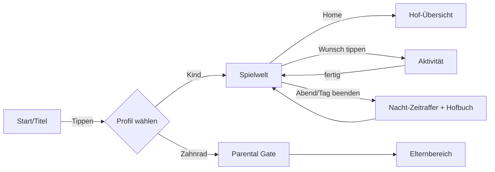

# 11 – Steuerung und Benutzeroberfläche

> Die Bedienung muss für 3-Jährige mit dicken, ungenauen Fingern genauso funktionieren wie für 8-Jährige, die präzise lenken wollen. Grundregel: **Alles Wichtige ist ein Bild, ein großes Ziel und eine Stimme.** Es gibt keinen Text im Kinder-UI.

## 1. Prinzipien

| # | Prinzip | Umsetzung |
|---|---|---|
| 1 | **Kein Text** | Piktogramme + Sprache; Ziffern erst ab Spross optional |
| 2 | **Große Ziele** | Mindest-Touch-Ziel 64 pt (Keimling 88 pt), nie < 44 pt |
| 3 | **Verzeihend** | Tippen auf „fast richtig“ zählt; Ziehen rastet magnetisch ein |
| 4 | **Eine Hand, ein Finger** | Alle Kernaktionen sind mit einem Finger möglich |
| 5 | **Kein versehentlicher Schaden** | Nichts ist zerstörbar/löschbar; kein Zurück-Dialog |
| 6 | **Sofortiges Feedback** | Jede Berührung reagiert < 100 ms (Animation + Ton + Haptik) |
| 7 | **Keine versteckten Gesten** | Kein Edge-Swipe-Zwang, kein Long-Press-Zwang, kein Pinch-Zwang |
| 8 | **Mitwachsend** | Steuerungsmodus pro Stage (siehe §4) |
| 9 | **Eltern-Bereiche gesperrt** | Gate für Nicht-Leser (§8) |

## 2. Grundgesten

| Geste | Verwendung | Alternative/Fallback |
|---|---|---|
| **Tippen** | Auswählen, Aktivieren, Ernten, Futter geben | – |
| **Ziehen (Drag)** | Items bewegen, Kanne führen, Lenken (Spross) | Tippen–Tippen (Quelle → Ziel) |
| **Wischen/Streicheln** | Tiere streicheln, Teig kneten | Tippen |
| **Halten** | Gießen (Kanne gedrückt halten) | Tippen = Auto-Gießen |
| **Zwei-Finger-Drag** | Kamera schwenken (ab Spross, optional) | Ortsleiste |
| **Pinch** | Zoom (optional, nur Blüte) | Zoom-Buttons (+/–) |
| **Doppeltippen** | – nicht verwendet | – |
| **Schütteln** | – nicht verwendet (Sensor-Fehlauslösung) | – |

**Gesten-Regeln:**
- Drag startet erst nach **8 pt** Bewegung (Fehltipp-Schutz), Keimling: 12 pt.
- Ziehen mit „Klebe-Finger“: Item folgt dem Finger mit leichter Verzögerung (lerp) – wirkt weich und verzeiht Zittern.
- **Zielmagnet:** Innerhalb eines Radius (Keimling 100 pt, Spross 70 pt, Blüte 45 pt) rastet das Item ein.
- Alle Gesten funktionieren **ohne präzises Timing** (kein „genau jetzt“).

## 3. Das HUD (Heads-up-Display)

Das HUD ist **minimal**; die Welt ist die Oberfläche.

```
┌──────────────────────────────────────────────────────┐
│ [🏠]  [Ort-Leiste: ⛰ 🐄 🏪 🌾 …]        [☀︎ Sonnenbogen]   │
│                                                        │
│                                                        │
│                   3D-Welt                              │
│       💬 💬 💬  (Wunsch-Blasen in der Welt)              │
│                                                        │
│                                                        │
│ [🐶 Pelle]                          [🧰 Werkzeugleiste] │
└──────────────────────────────────────────────────────┘
```

| Element | Position | Funktion | Größe |
|---|---|---|---|
| **Pelle-Button** | unten links | Antippen: Pelle wiederholt Hinweis / aktuelle Aufgabe („Was soll ich tun?“) | 96 pt |
| **Home-Button** (🏠) | oben links | Zurück zur Hof-Übersicht (Kamera Hof-Total) | 72 pt |
| **Ort-Leiste** | oben mitte (iPad) / unten (iPhone Hochformat) | Bildsymbole der freigeschalteten Orte → Kamerafahrt | 72 pt je Symbol |
| **Sonnenbogen** | oben rechts | Tagesfortschritt (rein visuell) | 80 pt |
| **Werkzeugleiste** | unten rechts | Kontextabhängig: Gießkanne, Samen, Hand, Bürste, Korb … | 80–96 pt je Werkzeug |
| **Hofbaum-Icon** | im Hof (3D-Objekt) – kein HUD | Fortschritt/Hofbuch öffnen | – |
| **Wunsch-Blasen** | in der Welt, an der Figur | Antippen: Kamera fährt hin, Pelle erklärt | 96 pt |

**Elternbereich-Zugang:** kleines Zahnrad **nur** im Startbildschirm und im Pausenmenü, hinter dem Parental Gate (§8). Nicht im Spiel-HUD.

### 3.1 Kontextabhängige Werkzeugleiste
- Zeigt **maximal 4** Werkzeuge (Keimling: 2).
- Werkzeug-Auswahl hat **Voice-Feedback** („Die Gießkanne!“).
- Aktives Werkzeug wird als Cursor-Hand/Werkzeug an der Fingerspitze gezeigt.
- Nicht passende Werkzeuge sind **ausgeblendet** (nicht ausgegraut) – weniger Ablenkung.

### 3.2 Pause / Menü
- **Pausen-Knopf:** Der Home-Button führt zur Hof-Übersicht; „Pause“ geschieht durch App-Hintergrund (Autosave).
- Pausenmenü (nur über Gate erreichbar für Eltern-Optionen): große Symbole **Weiter**, **Neuer Tag** (Ende-Tag-Ritual), **Elternbereich** (Gate).
- Kein „Spiel beenden“-Dialog für Kinder.

## 4. Steuerungsmodi nach Stage

| Funktion | Keimling (3–4) | Spross (5–6) | Blüte (7–8) |
|---|---|---|---|
| **Fortbewegung (Kamera)** | Pelle-Fokus: Tipp auf Wunsch/Ort → automatische Fahrt | + Ortsleiste, Zwei-Finger-Schwenk | + freie Kamera (Rotation 90°-Schritte, Zoom) |
| **Fahrzeuge** | **Autopilot**: Tipp auf Ziel, Fahrzeug fährt; Hupe = Tipp | **Spur-Ziehen**: Finger entlang Pfad, Magnet hilft | **Lenkrad + Gas-Schieber** (manuell), Autopilot optional |
| **Items bewegen** | Tippen → fliegt zum Ziel | Ziehen mit Magnet (großer Radius) | Ziehen, kleinerer Magnet |
| **Auswahl** | 2 Optionen, groß | 3–4 | 4–8 |
| **Zeit-Druck** | keiner | keiner | keiner |
| **Ziffern/Zahlen** | Punkte | Punkte + Ziffern | Ziffern |

> **Autopilot ist immer verfügbar** („Pelle fährt!“ – Button am Fahrzeug), unabhängig von der Stage.

### 4.1 Lenk-Hilfen (Formeln)

**Spur-Magnet (Spross):** Pfad `P(t)`, Finger-Position `f`. Fahrzeug-Zielposition:
```
target = lerp(f, closestPointOn(P, f), assist)         // assist ∈ [0.2, 0.9]
vehicle.pos += (target - vehicle.pos) * min(1, dt * k)  // k ≈ 6 (weich)
```
**Lenkrad (Blüte):** Lenkwinkel ∈ [-35°, 35°], Dämpfung 0,6, **Auto-Zentrierung**, **Rand-Sanftheit** (kein Aufprall): Bei Annäherung an Zaun/Rand dreht eine sanfte Rückstellkraft das Fahrzeug zurück.
**Gas:** Schieber 0–100 % (Max. 8 km/h-„Spielgeschwindigkeit“), Loslassen = Rollen/Halten.
**Rückwärts/Wenden:** automatisch (Fahrzeug wendet am Feldende selbst).
**Kollisionen:** Es gibt keine. Hindernisse verformen/weichen oder werden freundlich umfahren (z. B. Hühner hüpfen zur Seite, Pelle bellt).

## 5. iPhone vs. iPad

| Aspekt | iPhone (Hochformat/Querformat) | iPad (Querformat bevorzugt) |
|---|---|---|
| Ausrichtung | **Querformat** primär; Hochformat unterstützt (Layout angepasst) | Querformat primär; Hochformat unterstützt |
| Ort-Leiste | unten (Daumen-Reichweite), ausklappbar | oben |
| Werkzeuge | rechts unten (Daumen) | rechts unten |
| Touch-Ziele | 64–88 pt | 72–104 pt |
| Zwei Cursor (Co-Play) | – | **ja** (zwei Finger-Zonen/Spieler) |
| Kamera-Sichtfeld | enger (mehr Nahaufnahme) | breiter |
| Split View/Slide Over | – | **nicht unterstützt** (Vollbild) |

**Safe Areas:** Alle HUD-Elemente respektieren Safe Area Insets (Notch/Dynamic Island, Home-Indicator).
**Home-Indicator:** `prefersHomeIndicatorAutoHidden` im Spiel aktiv (versehentliches Verlassen vermeiden), Edge-Gesten dennoch zuverlässig (System-Gesten gehören dem OS).

## 6. Multitouch- und Palm-Handling

Kinder legen Hände/Handballen auf den Bildschirm:
- **Primär-Touch-Prinzip:** Das **erste** Touch einer Interaktion wird verfolgt; weitere gleichzeitige Touches werden ignoriert (außer Zwei-Finger-Schwenk ab Spross und Co-Play).
- **Handballen-Erkennung:** Touches mit großem Kontaktradius (> 28 pt) oder am Bildschirmrand (< 24 pt) ohne Bewegung werden verworfen.
- **Versehentliches Mehrfachtippen:** Doppelte Taps innerhalb 150 ms auf dasselbe Ziel zählen einmal.
- **Hängende Touches:** Touch-Cancel (Telefonanruf etc.) beendet Drag sauber, Item kehrt zurück.

## 7. Haptik

| Ereignis | Haptik (Core Haptics / UIFeedbackGenerator) |
|---|---|
| Item aufnehmen | leichter Impuls (`.light`) |
| Einrasten (Snap) | weicher Klick (`.soft`) |
| Aufgabe geschafft | warmes Muster (3 sanfte Pulse) |
| Traktor schnurrt | feines, dauerhaftes Rumpeln (Continuous, 20–30 % Intensität) |
| Tier streicheln | langsames Schnurren (Rhythmus) |
| Fehlversuch | **keine** Haptik (kein negatives Feedback) |

Haptik ist in den Eltern-Einstellungen abschaltbar; iPad ohne Taptic Engine: entfällt stillschweigend.

## 8. Parental Gate für Nicht-Leser

Die Gate-Aufgabe muss **für Kinder < 8 unlösbar bzw. unattraktiv, für Erwachsene mühelos** sein – ohne Lesen vorauszusetzen (Apple-Vorgabe für Kids-Apps, Guideline 1.3: Gate vor externen Links, Käufen, Einstellungen).

| Variante | Ablauf |
|---|---|
| **Standard** | **Text/Zahl-Rätsel auf dem Bildschirm**: z. B. „Gib die Zahl ‚sieben‘ ein“ (ausgeschrieben, ohne Stimme) plus Zahlenfeld. Nicht-Leser scheitern, Eltern nicht. |
| **Alternative (Hold)** | Zwei Ecken gleichzeitig 3 s halten **und** Zahl auf zufälliger Position tippen (motorisch + Zufall) |
| **Anti-Raten** | Nach 3 Fehlversuchen 30 s Sperre; Zufallsaufgaben ändern sich |
| **Kein Voice-Hinweis** | Pelle spricht im Gate **nicht** (sonst würden Kinder die Aufgabe vorgelesen bekommen) |
| **Barrierefreiheit** | VoiceOver-Nutzer: Gate bietet alternative Aufgabe (z. B. „Wähle die Summe von 3 + 4“) für Erwachsene mit Sehbehinderung |

Gate schützt: Elternbereich, Einstellungen, Rezension-Link, Support-Links, jegliche externe URL (siehe Doc 17).

## 9. Bildschirme (Flow)



**Startbildschirm:** Hof als Diorama, Pelle schläft/wacht auf; **ein einziger großer Spielen-Button** (Play-Dreieck auf einem Holzschild). Pelle spricht: „Hallo! Schön, dass du da bist!“ (Variante mit Kindesnamen, falls aufgenommen). Profilauswahl = Foto-Rahmen mit Tier-Avatar (kein Foto, kein Name).

## 10. UI-Technik (SwiftUI + RealityKit)

- **SwiftUI-Overlay** über `RealityView` für HUD (große Buttons, `.contentShape` für großzügige Trefferflächen).
- Gesten in der Welt über `SpatialTapGesture`/`DragGesture` (`.targetedToAnyEntity()`) mit eigener Input-System-Schicht für Magnete und Primär-Touch-Logik (Doc 15).
- Eingabe → **Intent-Events** (z. B. `Intent.pick(entity)`, `Intent.dragEnd(zone)`), damit Autopilot, Ghost-Hand und Touch dieselben Pfade nutzen (testbar, simulierbar).
- Alle Maße in **Punkten** über Skalierungstabelle pro Gerätegröße; Dynamic-Type spielt im Kinder-UI keine Rolle (kein Text), im Elternbereich schon.
