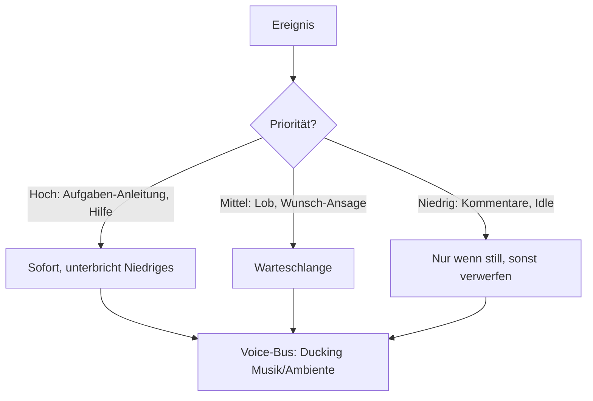
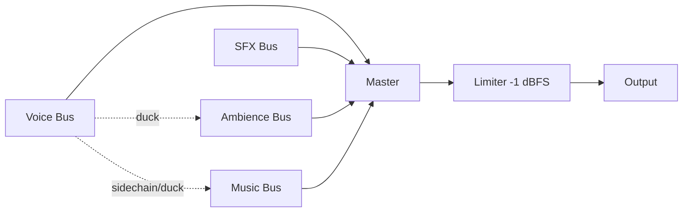

# 12 – Audio und Sprachausgabe (Voice-First)

> **Audio ist die Hauptschnittstelle des Spiels.** Kinder, die nicht lesen können, verstehen MiniFarm über Stimme, Klang und Bilder. Pelle erklärt nicht „Menüs“, sondern ist ein Begleiter, der mit dem Kind spricht, wie ein warmherziger großer Freund. Alle Sprachausgabe wird **vorab** (zur Build-Zeit) mit ElevenLabs erzeugt (Doc 13) und als Audio-Dateien ausgeliefert.

## 1. Audio-Prinzipien

| # | Prinzip | Bedeutung |
|---|---|---|
| 1 | **Voice-First** | Jede wichtige Information ist auch gesprochen; nichts Wesentliches nur als Text |
| 2 | **Wärme vor Info** | Tonfall zuerst freundlich, dann informativ |
| 3 | **Kurz** | Sätze ≤ 8 Wörter (Keimling), ≤ 12 (Spross), ≤ 16 (Blüte); Sprechpausen großzügig |
| 4 | **Positiv** | Nie „falsch/nein/nicht/leider“; immer einladend („Probier mal …“) |
| 5 | **Variabel** | Mehrere Varianten je Ereignis (kein monotones Wiederholen); Zufallsauswahl ohne Wiederholung der letzten 3 |
| 6 | **Nie überfordernd** | Max. **eine** Sprecherstimme gleichzeitig; Musik leiser, wenn gesprochen wird |
| 7 | **Offline & deterministisch** | Keine Laufzeit-TTS, kein Netzwerk (Kids-Category-konform, Doc 17) |
| 8 | **Beruhigend** | Lautstärke-Dynamik begrenzt; keine Schreckmomente, keine abrupten lauten Effekte |
| 9 | **Lokalisierbar** | Icon-first Design → Lokalisierung = neue Audio-Dateien (DE primär, EN später) |
| 10 | **Barrierefrei** | Untertitel/Transkripte optional im Elternbereich; Gebärden n/a |

## 2. Die Stimmen

### 2.1 Pelle (Hauptstimme)
- **Charakter:** Freundlicher Hofhund, warm, neugierig, ein bisschen verspielt, geduldig. Kein „Cartoon-Kläffen“, sondern eine sanfte, sympathische Erwachsenen-/Jugendlichenstimme mit leichtem Lächeln.
- **Sprechstil:** Ruhig, mittleres Tempo (Keimling: langsamer, ~120 Wörter/min; Blüte ~150), klare Artikulation, kleine Atem-/Lachlaute als Mikro-Reaktionen.
- **Tonlagen (Emotionen):** `warm` (Standard), `cheer` (Lob), `soft` (trösten/Abend), `curious` (Fragen/Hinweise), `sleepy` (Abendritual).
- **Er/sie?** Offen gehalten: Voice-Casting entscheidet (Doc 23, offene Frage). Empfehlung: warm-neutrale, leicht tiefe Stimme.

### 2.2 Dorfbewohner (Nebenrollen)
| Figur | Stimmcharakter |
|---|---|
| **Tilda** (Bäckerin) | Herzlich, mütterlich, lachend |
| **Opa Hanno** | Brummig-gütig, langsam, Geschichten-Ton |
| **Mo** (Nachbarskind) | Helle Kinderstimme, aufgeregt, neugierig |
| **Lale** (Postbotin) | Flott, fröhlich, klar |
| **Yusuf** (Markthändler) | Warm, rufend, humorvoll |

Jede Figur hat einen **kleinen Satz-Pool** (Begrüßung, Wunsch, Dank, Abschied). Nebenstimmen sind **kurz** (1–2 Sätze), Pelle liefert die Anleitung.

### 2.3 Tiere
Tiere sprechen **nicht** in Worten, sondern mit Lauten und kleinen Lautmalereien (Muh, Mäh, Gack). Für Wortschatz-Lernen benennt Pelle sie („Das ist die Kuh Rosa.“). Tiere haben **Persönlichkeits-Laute** (Doc 06): die Kuh brummt tief, die Ziege meckert fröhlich.

### 2.4 Voice-Casting-Optionen (ElevenLabs)
1. **Designte Stimmen** (Voice Design / `text_to_voice`): Beschreibung → Vorschläge, Auswahl im Team.
2. **Voice Library**-Stimmen (Lizenz prüfen: kommerziell, Kinder-Medien erlaubt?).
3. **Eigene/Sprecher-Aufnahmen** (Professional Voice Clone nur mit schriftlicher Zustimmung der Sprecherin/des Sprechers und passenden Rechten).

> Rechtliche Hinweise: Doc 13 §8. **Stand der Plattform/ToS vor Produktion prüfen.**

## 3. Sprach-Kategorien (Voice-Line-Typen)

| Kategorie | Präfix | Beispiel | Länge |
|---|---|---|---|
| Begrüßung/Abschied | `vl.pelle.greet.*` | „Hallo! Schön, dass du da bist!“ | 1 Satz |
| Wunsch-Ansage | `vl.wish.*` | „Rosa möchte Heu.“ | 1–2 Sätze |
| Anleitung (Schritt) | `vl.pelle.<act>.<step>` | „Zieh das Heu zum Trog.“ | 1 Satz |
| Hinweis (Scaffold 1) | `vl.hint.*` | „Schau mal, der rote Apfel!“ | 1 Satz |
| Lob | `vl.praise.*` | „Toll gemacht!“ / „Gemeinsam geschafft!“ | 1 Satz |
| Zählen | `vl.count.1..20` | „Eins. Zwei. Drei.“ | Wort |
| Wortschatz | `vl.vocab.<item>` | „Der Apfel.“ | Wort |
| Erzähl-/Stimmung | `vl.story.*` | „Es wird Abend. Die Sonne geht schlafen.“ | 1–2 Sätze |
| Jahreszeiten | `vl.season.*` | „Schau, der Schnee fällt!“ | 1–2 Sätze |
| Ritual | `vl.ritual.*` | Abendritual, Gute-Nacht | kurz |
| Lieder/Reime | `vl.song.*` | Pelles Lied, Wiegenlied | ≤ 30 s |
| Dorfbewohner | `vl.npc.<id>.*` | „Ich hätte gern Karotten.“ | 1 Satz |
| Eltern-/Systemhinweise | – | **keine Sprachausgabe** (Elternbereich ist Text) | – |

**Mengenschätzung (Vertical Slice → Voll):** ~600 Zeilen (Slice) → ~4000 Zeilen (Vollversion, inkl. Varianten). Detail in Doc 13/21.

## 4. Positive Sprache – Style Guide

| Statt … | besser … |
|---|---|
| „Falsch!“ / „Nein!“ | „Hm, probier mal den roten!“ |
| „Das geht nicht.“ | „Das mag die Kuh lieber so.“ |
| „Du hast verloren/verpasst.“ | (existiert nicht) |
| „Schnell!“ / „Beeil dich!“ | „Wir haben Zeit.“ |
| „Nochmal!“ (als Tadel) | „Wollen wir es noch mal zusammen probieren?“ |
| „Das ist ganz einfach.“ | „Ich helfe dir.“ (Bewertung vermeiden) |
| „Gut gemacht, du bist so schlau!“ | „Du hast gut geschaut!“ (Anstrengung/Handlung loben, keine Eigenschaften) |

**Lob-Prinzipien:**
- **Prozess- statt Personenlob:** „Du hast gut gezählt“ statt „Du bist klug“.
- **Konkret:** Nennt, was geschah („Zwei Äpfel und eine Milch – genau richtig!“).
- **Variabel:** ≥ 40 Lob-Varianten; nie dieselbe zweimal hintereinander.
- **Proportional:** Kleine Aktion – kurzes Lob; Aufgabe – größeres Lob; Tagesende – warmes Fazit.
- **Nicht überschwänglich**, keine Dauer-Fanfaren (Reiz-Überflutung vermeiden).

**Anrede:** Du-Form, einfache Wörter, Präsens, aktive Sätze. Keine Ironie, keine Redewendungen, die Kinder wörtlich missverstehen („Das ist ein Klacks“ vermeiden).

## 5. Sprach-Steuerung (Wann spricht Pelle?)

| Regel | Wert |
|---|---|
| **Stille nach Aufgabenstart** | 1,5 s (Kind betrachtet erst) |
| **Idle-Kommentare** | frühestens nach 20 s Stille, max. alle 45 s, nie in Aufgaben |
| **Wiederholung** | Pelle-Button spielt Hinweis erneut (alternative Variante) |
| **Unterbrechung** | Kind-Aktion unterbricht niedrige Priorität sofort; hohe Priorität (Anleitung) wird fertig gesprochen, wenn < 2 s Rest |
| **Cooldown je Zeile** | gleiche `lineId` nicht innerhalb 3 min, gleiche Kategorie nicht 2× in Folge |
| **Lautstärke** | Voice = Referenz; Musik −12 dB beim Sprechen (Ducking), Ambiente −6 dB |
| **Reaktion auf Kinder-Sprache** | **Keine** Spracherkennung (Datenschutz); Pelle „hört“ nicht zu |

## 6. Audio-Architektur (Buses & Mix)

| Bus | Inhalt | Ziel-Pegel (relativ) |
|---|---|---|
| **Voice** | Pelle, NPC, Lieder-Gesang | 0 dB (Referenz, ~ −16 LUFS integriert) |
| **SFX** | Interaktionen, Tiere, Maschinen | −6 bis −10 dB; Peak ≤ −6 dBFS |
| **Ambience** | Wind, Vögel, Hof-Atmo (positional) | −14 dB |
| **Music** | Jahreszeit-Themen, Schlaflied | −16 dB (−28 dB beim Sprechen) |

- **Technik:** `AVAudioEngine` + `AVAudioEnvironmentNode` (räumlich) oder RealityKit-Audio (`SpatialAudioComponent`, `AudioPlaybackController`). Voice **nicht räumlich** (immer „im Kopf“), Tiere/Maschinen **räumlich** (Orientierung in der Welt).
- **Format:** AAC `.m4a` (Sprache 64–96 kbps mono, SFX/Musik 128 kbps), Loops als CAF/ALAC falls Gapless nötig.
- **Latenz:** SFX < 50 ms (Haptik gleichzeitig); Voice vorgeladen (Prefetch der Tages-Zeilen).
- **Unterbrechungen:** `AVAudioSession` Kategorie `.ambient`/`.playback` (Mix-Option für Eltern-Musik **aus**; Spiel nutzt eigene Audio); Handling von Anrufen, Kopfhörer-Trennung (Pause).
- **Hörschutz:** Systemlautstärke-Respekt; interner Limiter; keine Pegelspitzen. Kopfhörer-Hinweis für Eltern (Elternbereich).

## 7. Sound-Design (SFX & Ambiente)

| Bereich | Beispiele | Gestaltungsregel |
|---|---|---|
| **UI/Interaktion** | Tippen („Plopp“), Einrasten („Klack“), Münzen („Klimper“), Klingel | Weich, rund, holzig/organisch, keine Digital-Pieptöne |
| **Tiere** | Muh, Mäh, Gack, Wiehern, Oink, Schnurren, Bellen | Echte Aufnahmen + stilisiert, freundlich, nie schrill |
| **Maschinen** | Traktor-Brummen, Pflugschar, Mähdrescher, Hupe | Gedämpft, rhythmisch, „Spielzeug-Charme“, Drehzahl folgt Gas |
| **Natur** | Vögel, Bach, Wind, Regen, Schnee-Knirschen | Dezente Loops, räumlich, Jahreszeit-Sets |
| **Erfolg** | Aufsteigende Glockenspiel-Phrasen (Pentatonik) | Kurz (< 1,5 s), nie schrill |
| **Kein Fehlerton** | – | Fehlversuch = neutrales „Plop“/Wackeln, **kein** Buzzer |

**Generierung:** SFX via ElevenLabs `text_to_sound_effects` (Modell `eleven_text_to_sound_v3`, Stand prüfen) und/oder lizenzierte Libraries/Foley; alles QA-geprüft (Doc 13 §6).

## 8. Musik

| Funktion | Gestaltung |
|---|---|
| **Jahreszeit-Themen** | 4 Hauptthemen à 2–3 Minuten (Loops), akustisch (Gitarre, Flöte, Cello, Spieluhr, Harfe, Ukulele, Klavier), 70–90 BPM, Pentatonik/Dur, sehr leise |
| **Tageszeit-Variation** | Morgen leicht, Abend ruhig, Nacht Wiegenlied |
| **Aufgaben-Stinger** | 1–2 s Motive beim Abschluss |
| **Schlaflied** | Abend-/Nachtritual (≤ 60 s, ruhig, vorlesbar/gesungen von Pelle) |
| **Pelles Lied** | Rhythmisches Mitmach-Lied (Tierlaute-Reihenfolge, `act.farm.sing`) |
| **Dynamik** | Kein Dauerbrenner: Musik pausiert regelmäßig (Stille-Phasen von 20–40 s) |

**Musik-Quelle:** ElevenLabs Music (`music_v2_5`, Stand prüfen) und/oder lizenzierte Komposition. Musik-Optionen für Eltern: **Musik an/aus**, **nur Ambiente**.

## 9. Namens-Aufnahme und persönliche Stimmen (optional)

- **Kindname:** Eltern können im Elternbereich (Gate) den Namen des Kindes **mit dem Mikrofon aufnehmen** (3 Aufnahmen, Auswahl). Pelle ruft „Hallo, [Name]!“ als eingeschnittene Audio-Datei (lokal gespeichert, nie hochgeladen).
- Mikrofon-Berechtigung nur im Elternbereich, mit Erklärtext; Aufnahme **bleibt lokal**; jederzeit löschbar.
- **Eltern-Stimme (optional, später):** Eltern nehmen Gute-Nacht-Sätze auf („Gute Nacht, mein Schatz“) – lokal, nicht geteilt.
- Fallback ohne Aufnahme: neutrale Zeile („Hallo, schön, dass du da bist!“).

## 10. Mehrsprachigkeit

- **Primärsprache:** Deutsch (Standard Hochdeutsch, klare Aussprache).
- **Zielsprachen später:** Englisch (Priorität 1), weitere nach Markt.
- **Pipeline:** Zeilen-Katalog mit `text_de` / `text_en`; Audio pro Sprache; Auswahl nach System-Sprache + Eltern-Override.
- **Bilingual-Option (später):** „Pelle spricht auch Englisch“ als Wortschatz-Modus (`vl.vocab.*` in zwei Sprachen).
- Wegen Icon-first-UI kostet Lokalisierung **nur** Audio (keine Layout-Änderungen).

## 11. Barrierefreiheit im Audio

- **Hör-Beeinträchtigung:** Optionale **Untertitel-Blasen** (Piktogramm + kurzer Text) und visuelle Hinweise für alle wichtigen Töne; Aufgaben nie *nur* über Ton lösbar.
- **Sensorisch empfindlich:** Lautstärke-Regler je Bus, „leises Spiel“-Modus (Musik/Ambiente aus), Effekt-Intensität.
- **Sprach-Tempo:** Optional „langsamer sprechen“ (alternative, langsamere Aufnahmen oder Time-Stretch ohne Pitch-Änderung, zu prüfen).

## 12. Messung und Qualitätsziele

| Ziel | Wert |
|---|---|
| Voice integriert | −16 LUFS ±1; True Peak ≤ −1 dBTP |
| SFX Peak | ≤ −6 dBFS |
| Voice-Latenz (Tippen → Sprache) | < 300 ms (Prefetch) |
| Stille-Spannen | Mind. 40 % der Spielzeit ohne Sprache |
| Wiederholungsrate | Gleiche Zeile < 1× pro 10 min im Mittel |
| Dateigröße Sprache (Slice) | ≤ 60 MB gesamt (Slice); Voll-App ≤ 400 MB Audio gesamt (inkl. Musik) – streamingfähig on-demand (Doc 15) |
