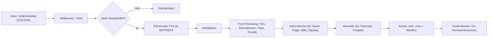

# 13 – ElevenLabs-Pipeline (Sprache, SFX, Musik)

> Dieses Dokument beschreibt, wie alle Audio-Assets **zur Build-Zeit** über ElevenLabs (MCP-Server und/oder REST-API) erzeugt, geprüft und in das Spiel eingebunden werden. **Die App selbst nutzt zur Laufzeit keine ElevenLabs-Dienste.**
>
> ⚠️ **Stand-Hinweis:** Modellnamen, Limits, Preise und Lizenzbedingungen ändern sich schnell. Alle Angaben mit „(Stand prüfen)“ vor Produktionsbeginn gegen die aktuelle ElevenLabs-Dokumentation verifizieren.

## 1. Entscheidung: Vorab-Generierung statt Laufzeit-TTS

| Kriterium | Vorab-Generierung (gewählt) | Laufzeit-TTS (verworfen) |
|---|---|---|
| Kids-Category / Datenschutz | ✅ Keine Netzwerkaufrufe, keine Daten abfließend | ❌ Netzwerk, Drittanbieter, Daten |
| Offline-Spielbarkeit | ✅ | ❌ |
| Qualitäts-/Konsistenzkontrolle | ✅ QA jeder Zeile | ❌ nicht kontrollierbar |
| Latenz | ✅ sofort | ❌ Netzwerk-Latenz |
| Kosten im Betrieb | ✅ einmalig (Credits) | ❌ pro Nutzer/Spiel |
| Flexibilität | ⚠️ App-Update für neue Zeilen | ✅ |

Ausnahmen: keine. (Optional später: **On-Demand-Resources** für Sprachpakete.)

## 2. Pipeline-Überblick



### 2.1 Werkzeuge
- **ElevenLabs MCP-Server** (offiziell; wird später vom Auftraggeber angebunden) mit Tools u. a.: `text_to_speech`, `text_to_sound_effects`, `text_to_voice` (Voice Design), `speech_to_speech`, `isolate_audio`, `list_models`, … (Stand prüfen).
- **Skripte** (`tools/audio/`): Python/Swift-CLI, die den Katalog liest, nur **geänderte** Zeilen erzeugt (Content-Hash), Dateien nach Schema benennt, `ffmpeg` für Post-Processing nutzt und ein **Manifest** (`voicelines.manifest.json`) schreibt.
- **Reproduzierbarkeit:** Jede Generierung speichert Modell, Voice-ID, Settings, Seed (falls vorhanden), Hash, Zeitstempel im Manifest.

## 3. Zeilen-Katalog (Quelle der Wahrheit)

CSV/JSON in `content/voicelines/`. Jede Zeile:

| Feld | Beispiel | Beschreibung |
|---|---|---|
| `id` | `vl.pelle.praise.047` | Eindeutige ID (stabil, nie wiederverwenden) |
| `character` | `pelle` | Sprecher-Figur |
| `category` | `praise` | Kategorie (Doc 12 §3) |
| `text_de` | „Du hast gut gezählt!“ | Gesprochener Text (Plain) |
| `text_tts` | „Du hast gut gezählt!“ | TTS-Eingabe (mit Tags/Aussprache; kann von `text_de` abweichen) |
| `emotion` | `cheer` | `warm/cheer/soft/curious/sleepy` |
| `stage_min` / `stage_max` | `sprout`/`bloom` | Zielgruppenfilter (Tempo/Satzlänge) |
| `context` | `act.shop.order.done` | Auslöser/Verwendung |
| `variants_group` | `praise.generic` | Variantengruppe für Zufallsauswahl |
| `priority` | `mid` | `high/mid/low` |
| `max_duration_s` | `3.0` | Obergrenze (QA) |
| `tags` | `season:winter` | Filter (Saison/Ort) |
| `status` | `approved` | `draft/generated/review/approved/rework` |
| `hash` | `sha1(...)` | Hash aus Text+Voice+Settings |

**Benennung Datei:** `vo_<lang>_<id>.m4a` (z. B. `vo_de_vl.pelle.praise.047.m4a`).

## 4. TTS-Einstellungen und Prompting

### 4.1 Modellwahl (Stand prüfen)

| Einsatz | Modell-Empfehlung | Begründung |
|---|---|---|
| Pelle & NPC (Hauptsprache) | `eleven_v3` / neuestes Expressiv-Modell (z. B. `eleven_v4`, falls verfügbar) | Beste Ausdrucksstärke, Audio-Tags (z. B. `[warmly]`, `[laughs softly]`) |
| Massenzeilen (Zählen, Wortschatz) | `eleven_multilingual_v2` oder `eleven_flash_v2_5` | Stabil/konsistent, günstig, schnell |
| Zeichenlimit | v3: ≈ 5.000 Zeichen je Request | Zeilen sind kurz, Limit irrelevant |

> **Entscheidung (Autopilot-Annahme):** Pelles Zeilen mit expressivem Modell erzeugen, Zähl-/Wortschatzzeilen mit stabilem Modell, damit Betonung und Tempo einheitlich bleiben. **A/B-Hörtest** in Phase 0 (Doc 19) entscheidet final.

### 4.2 Voice Settings (Startwerte, per Hörtest tunen)

| Einstellung | Startwert | Wirkung |
|---|---|---|
| Stability | 0,55–0,70 | höher = konsistenter; niedriger = lebhafter |
| Similarity/Clarity | 0,75 | Nähe zur Referenzstimme |
| Style (Exaggeration) | 0,10–0,30 | Ausdrucksstärke (moderat halten) |
| Speed | 0,90 (Keimling) / 1,0 | langsamer für junge Kinder |
| Speaker Boost | an | Klarheit |

### 4.3 Prompting-Muster
- **Kurze Sätze**, Satzzeichen steuern Prosodie; Auslassungspunkte sparsam.
- **Audio-Tags** (nur v3/v4, sparsam): `[softly]`, `[cheerfully]`, `[curious]`, `[sleepy]`, `[laughs softly]`, `[whispers]` – nie Schreien/Wut/Angst-Tags.
- **Zahlen und Abkürzungen** ausschreiben („zwei“ statt „2“).
- **Kontext** über Nachbarzeilen (`previous_text`/`next_text`), um Intonation zu stabilisieren (Stand prüfen).
- **Aussprache-Wörterbuch** (Pronunciation Dictionary): Eigennamen (Pelle, Minka, Tilda, Hanno, Yusuf, Lale), Fachwörter (Mähdrescher, Ballenpresse).
- **Varianten:** gleiche Aussage in 3–5 Formulierungen erzeugen; nie nur Re-Rolls derselben Zeile (Betonung variiert sonst unkontrolliert).
- **Atem/Pausen:** `<break time="0.4s"/>`-Tags (nur wo Modell unterstützt, Stand prüfen) oder Satzzeichen.

### 4.4 Beispiel-Eingabe (Pseudocode MCP/REST)

```json
{
  "tool": "text_to_speech",
  "arguments": {
    "text": "[cheerfully] Zwei Äpfel und eine Milch – genau richtig!",
    "voice_id": "<PELLE_VOICE_ID>",
    "model_id": "eleven_v3",
    "language_code": "de",
    "stability": 0.6,
    "similarity_boost": 0.75,
    "style": 0.2,
    "speed": 0.95,
    "output_format": "mp3_44100_128"
  }
}
```

(Parameter-Namen je nach MCP-Tool/REST-Version prüfen.)

## 5. Dynamische Sätze (Mengen, Namen, Wortschatz)

Dynamische Texte („Zwei Äpfel und eine Milch“) sind bei Vorab-Generierung problematisch. Lösung: **Baustein-Sprache**.

| Technik | Beschreibung |
|---|---|
| **Satzrahmen + Slots** | „Ich hätte gern ___ und ___.“ mit separat erzeugten Slot-Wörtern (Zahl + Item); **Prosodie-Anpassung** durch Aufnahme der Slots im Satzkontext (mehrere Kontext-Varianten: Satzanfang/-mitte/-ende) |
| **Konkatenation mit Crossfade** | 30–60 ms Crossfade, vorgefertigte Kombinationen für häufige Fälle (Zahl × Item für Mengen 1–5) |
| **Item-Wortschatz** | `vl.vocab.<item>` in Nennform + `vl.item.<item>.acc` (Akkusativ: „einen Apfel“) + Plural |
| **Grammatik-Tabelle** | pro Item: Artikel, Genus, Singular/Plural, Akkusativ → Generator baut Lookup-Schlüssel |
| **Vollständige Vorab-Kombinationen** | für Top-Bestellungen (1–2 Item-Typen) komplett vorerzeugen; Rest per Baustein |
| **Kind-Name** | Aufnahme der Eltern, Einschnitt am Satzanfang/-ende (`Hallo, [Name]!`) |

Der Generator in der App wählt **Lookup + Konkatenation**; Zufalls-Varianten bleiben erhalten. Grammatik-Fehler vermeiden: Kataloge prüft ein Unit-Test (Doc 20).

## 6. SFX und Musik

### 6.1 Sound-Effekte (`text_to_sound_effects`, Modell `eleven_text_to_sound_v3`, Stand prüfen; Vorgänger-Modell wird laut Ankündigung eingestellt)
- Prompts beschreiben Quelle, Material, Stimmung, Dauer: *„Weiches, freundliches Muhen einer Kuh, kurz, warm, ohne Hall, Kinderspiel-Stil.“*
- Looping-Effekte (Traktor, Regen): in Phase 0 testen, Loop-Punkte nacharbeiten (ffmpeg/Audacity); notfalls lizenzierte Libraries.
- Tierlaute: Mischung aus generiert + Foley/Libraries; **Realismus prüfen** (nicht erschreckend).
- Jeder SFX: 3–5 Varianten (Pitch/Timing-Variation zur Laufzeit zusätzlich).

### 6.2 Musik (`music_v2_5`, Stand prüfen)
- Prompts: Instrumentierung, BPM, Tonart, Stimmung, Loop-Fähigkeit, **instrumental**, keine Vocals.
- Ergebnis wird **nachbearbeitet** (Loop-Schnitt, Lautheit, Fade); Komponist:in kann das Ergebnis ersetzen/ergänzen.
- **Rechteklärung:** Musik-Output und eventuelle Ähnlichkeiten prüfen; ggf. menschliche Komposition für Kern-Themen (Marketing/Wert, Doc 17).

## 7. Qualitätssicherung

### 7.1 Automatisch (CI-Skript)

| Check | Grenze |
|---|---|
| Dauer ≤ `max_duration_s` | sonst „rework“ |
| Integrierte Lautheit | −16 LUFS ±1,5 (Voice) |
| True Peak | ≤ −1 dBTP |
| Führungs-/End-Stille | ≤ 80 ms / ≤ 200 ms (trim) |
| Clipping | 0 Samples |
| Rauschboden | ≤ −60 dBFS in Stille |
| Spektral-Anomalien (Artefakte) | Warnung (optional, ML-gestützt) |
| Manifest-Konsistenz | jede Katalog-ID hat Datei, keine Waisen |

### 7.2 Manuell (Hörprobe)

- **Checkliste:** Aussprache, Betonung, Emotion passend, Tempo, Wärme, Artefakte (Zischen, Knacken), Kinder-Eignung (nicht gruselig), Konsistenz zu Nachbarzeilen.
- **Stichprobe bei Vollkatalog:** 100 % neu generierter Zeilen von mindestens einer Person gehört; 20 % von zweiter Person; **Kinder-Hörtest** (3–8 J.) für Kern-Sets.
- Freigabe-Status im Katalog (`approved`); nur `approved` gelangt in Release-Builds.

### 7.3 Post-Processing (ffmpeg, Beispiel)

```bash
ffmpeg -i raw.mp3 \
  -af "silenceremove=start_periods=1:start_threshold=-50dB,loudnorm=I=-16:TP=-1.5:LRA=7" \
  -ar 44100 -ac 1 -c:a aac -b:a 80k out.m4a
```

## 8. Lizenzen, Recht und Compliance (Stand prüfen)

| Thema | Vorgehen |
|---|---|
| **Kommerzielle Nutzung** | Nur mit **bezahltem Plan** (Starter oder höher); der Free-Plan erlaubt keine kommerzielle Nutzung. Audio, das während eines aktiven Abos erzeugt wurde, bleibt nach ToS lizenziert (Stand prüfen). |
| **Voice Library** | Stimmen einzeln auf **kommerzielle Nutzung** und Rechte-Inhaber-Bedingungen prüfen; Screenshot/Dokumentation der Lizenzlage pro Stimme ablegen |
| **Voice Cloning** | Nur mit **schriftlicher Einwilligung** der Person, vertraglich geregelt (Nutzungsumfang, Dauer, Widerruf) |
| **KI-Kennzeichnung** | Vorgaben prüfen (EU AI Act Transparenzpflichten, Apple-Richtlinien, ggf. Hinweis im Elternbereich/Credits) |
| **Kinder-Daten** | Keine Kinderstimmen von Spielern verarbeiten; Mo-Stimme als **designte/gecastete** Stimme (keine echten Kinderstimmen ohne Jugendschutz-/Arbeitsrecht-Klärung) |
| **Datenschutz Pipeline** | Katalogtexte enthalten keine personenbezogenen Daten |
| **Dokumentation** | `docs/licenses/audio.md` (Voice-IDs, Lizenzquelle, Datum, Plan, ToS-Version) |

> **Hinweis:** Keine Rechtsberatung. Vor Release juristische Prüfung (Kids-Apps, KI-Stimmen).

## 9. Verbindung zum MCP (Arbeitsweise)

Sobald der Auftraggeber den ElevenLabs-MCP-Server anbindet:
1. **Stimmen-Findung:** `text_to_voice` (Voice Design) mit Beschreibungen für Pelle/NPCs, 3–5 Kandidaten → Team-Auswahl → Voice-ID fixieren.
2. **Prototyp-Set:** 30 Pelle-Zeilen (Begrüßung, Lob, Hinweis, Zählen) in 2–3 Modellen/Einstellungen → A/B-Hörtest.
3. **Batch-Generierung** der Vertical-Slice-Zeilen (~600) mit Pipeline-Skript.
4. **QA-Runde**, Korrekturschleife (nur geänderte Zeilen neu).
5. **SFX-/Musik-Prototypen**, Loop-Tests.
6. **Vollproduktion** nach Slice-Freigabe.

**Credit-Planung:** Zeichen × Preis je Modell (Stand prüfen); Reserve +50 % für Re-Generierungen. Kostenrahmen in Doc 19.

## 10. Versionierung und Änderungsmanagement

- Katalog-Hash + Voice-Settings-Hash bestimmen Re-Generierung.
- **Voice-Wechsel = Neuerzeugung aller Zeilen** (teuer) → Stimme früh fixieren (Phase 0).
- Manifest im Repo (Git LFS für Audio-Binärdateien).
- **Changelog** je Audio-Release (neue/geänderte IDs).
