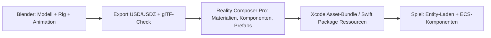

# 14 – Art Direction und Assets

> Der Look ist **weich, warm, handgemacht** – ein lebendiges Spielzeug-Diorama. Wenige, klare Formen, große Silhouetten, ruhige Farben. Alles ist rund, nichts ist spitz oder bedrohlich. Die Optik muss auf einem Telefon-Bildschirm aus 30 cm Abstand genauso lesbar sein wie auf dem iPad.

## 1. Stilleitlinien

| Aspekt | Festlegung |
|---|---|
| **Gesamtstil** | „Stylized Toy Diorama“: Low-Poly mit weichen Bevels, handbemalte Texturen, Holz-/Filz-/Stoff-Anmutung. Keine Photorealismus. |
| **Formensprache** | Rund, kompakt, übergroße Köpfe/Augen bei Tieren, dicke Beine, keine scharfen Kanten |
| **Proportionen** | Chibi-Verhältnisse für Tiere/Figuren; Maschinen „pummelig“ (großer Traktor, kleine Details) |
| **Farbwelt** | Warme, gesättigte, aber nicht grelle Töne; Jahreszeit-Paletten (Doc 08); hohe Luminanz-Kontraste für Spielelemente |
| **Licht** | Weiches, warmes Key-Light, Ambient-Fill, sanfte Schatten (Contact Shadows), kein hartes Ray-Look |
| **Outline** | Optional leichte Silhouetten-Kontur an interaktiven Objekten (Fresnel-Rim), um Interaktivität zu zeigen |
| **Materialien** | PBR vereinfacht (BaseColor + sehr dezente Roughness); Toon-Ramp-Shading (optional) für Charakter |
| **Animation** | Squash & Stretch, Anticipation, übertrieben-weiche Bewegung; alles „atmet“ |
| **Gesichter** | Einfache Augen (große, glänzende Pupillen), kleine Münder, klare Emotionen (froh, neugierig, müde); keine Angst/Wut-Gesichter |
| **Diversität** | Menschenfiguren mit vielfältigen Hautfarben, Körperformen, Frisuren, Kleidung; Geschlechterrollen nicht klischeehaft |

## 2. Farbpaletten (Basis, Hex-Richtwerte)

| Rolle | Frühling | Sommer | Herbst | Winter |
|---|---|---|---|---|
| Himmel | `#BFE6F2` | `#7FC8F0` | `#F3D9A8` | `#C9D9EA` |
| Gras/Boden | `#9ED67A` | `#6DBE4B` | `#C9A44C` | `#E8EEF3` |
| Akzent 1 | `#F7A8C4` | `#FFD24D` | `#E8803A` | `#7EA8D8` |
| Akzent 2 | `#FFE08A` | `#FF7A59` | `#B5522B` | `#F5C85A` |
| Holz (Bauten) | `#B97F4F` | `#B97F4F` | `#9C6A42` | `#8A5F3D` |
| Schatten-Tint | `#6B7FBF` | `#5B6FB0` | `#7B5A8A` | `#5A6A9A` |

**UI-Farben (Aufgaben-Kategorien):** Tiere `#FFC94D` · Feld `#6DBE4B` · Laden `#F0715A` · Küche `#A8744F` · Natur `#4DA3E0`.

**Barrierefreiheit:** Information wird nie **nur** über Farbe vermittelt (Form + Piktogramm + Ton). Farbe-Paare werden auf Rot-Grün-Schwäche getestet (Simulator/Color Oracle).

## 3. Charakter-Design

### 3.1 Pelle (Hofhund)
- Mittelgroßer, kuscheliger Mischling (Border-Collie-Anmutung), weiß-braun, **ein Schlappohr/ein aufgestelltes Ohr** (Wiedererkennung), bunter Halstuch-Stoff (Jahreszeit-Variationen).
- Mimik: 8 Basis-Emotionen (freudig, neugierig, stolz, sanft, müde, überrascht, nachdenklich, lachend).
- Animationen: Idle (hecheln, Schwanzwedeln), Gehen, Laufen, Sitzen, Zeigen (Pfote/Nase), Lob-Sprung, Gähnen, Schlafen, Sprechen (Lippensync einfach/Jaw-Flap), Ghost-Hand-Hinweise (Schnauze deutet).

### 3.2 Tiere (siehe Doc 06)
Je Tier: Silhouette erkennbar in < 0,5 s; 6–8 Animationen (Idle, Gehen, Fressen, Trinken, Schlafen, Freude, Streicheln, Laut). Babys: größere Köpfe, wackeliger Gang.

### 3.3 Dorfbewohner
Je Figur: 5–6 Animationen (Idle, Winken, Gehen, Zeigen, Freuen, Sprechen). Stilisiert, nicht realistisch; Alter/Hautton/Kleidung vielfältig.

### 3.4 Hand/Cursor
Weiche Cartoon-Hand mit Handschuh; Ghost-Hand (halbtransparent, pulsierend) zeigt Gesten. Wird in Jahreszeit-/Werkzeug-Varianten angepasst.

## 4. Welt- und Umgebungsdesign

- **Diorama-Look:** Insel mit leicht überhöhtem Boden-Rand (Schnittkante mit Erdschichten), „Spielbrett“-Gefühl (Doc 04).
- **Raster 1 m** (Gameplay) mit organischen Übergängen (keine sichtbaren Gitter, außer Feld-Beete).
- **Objekt-Sprache:** Zäune, Scheunen, Gewächshäuser aus Holz/Weiß; Dächer abnehmbar (Cutaway, Doc 04).
- **Lesbarkeit:** Interaktive Objekte haben leichte Rim-Highlights + „Pulse“ bei Cue; dekorative Objekte nicht.
- **Details:** Windbewegte Gräser (Shader), Schmetterlinge, Vögel, Wolkenschatten – dezent.

## 5. Asset-Liste (Umfang) und Budgets

### 5.1 Kategorien und Mengen (Vollversion, Richtwerte)

| Kategorie | Stück | Hinweise |
|---|---|---|
| Tiere (inkl. Babys) | 9 Nutztier-Arten (Huhn, Kuh, Schaf, Schwein, Ente, Ziege, Pferd, Kaninchen, Biene) × 2 (Erw./Baby; Biene ohne Baby) ≈ 17 + Minka | Rig + Animationen |
| Menschenfiguren | 5 + 3 Statisten | Rig-Sharing (Basis-Skelett) |
| Pelle | 1 | Extra-Detail + Emotionen |
| Fahrzeuge/Geräte | 11 | Teile animiert (Rad, Pflug, Haspel) |
| Gebäude | 10 (Scheune, Stall, Hühnerstall, Laden, Küche, Mühle, Gewächshaus, Brunnen, Haus, Schuppen) | modular, Cutaway-Dächer |
| Pflanzen (Wachstumsstufen) | 14 Kulturen × 4 Stufen = 56 | Instancing |
| Items/Produkte | ~60 | kleine Meshes/Icons |
| Deko | ~80 | Zäune, Bänke, Laternen, Windräder … |
| Natur (Bäume, Büsche, Steine, Blumen) | ~40 | je 4 Saison-Varianten per Material-Swap |
| Wetter-/Partikel-Presets | ~15 | Regen, Schnee, Blätter, Funken |
| UI-Piktogramme | ~250 | Vektor (PDF/SVG) → Asset-Katalog |
| Audio | siehe Doc 12/13 | |

### 5.2 Technische Budgets

| Asset | Dreiecke | Textur | Bones |
|---|---|---|---|
| Hauptfigur Pelle | ≤ 12k | 2048² (Atlas) | ≤ 60 |
| Tier (Erw.) | ≤ 8k | 1024² | ≤ 40 |
| Tier (Baby) | ≤ 5k | 1024² | ≤ 30 |
| Mensch | ≤ 8k | 1024² | ≤ 50 |
| Fahrzeug | ≤ 15k | 2048² | – (Teil-Animation) |
| Gebäude (modular) | ≤ 10k | Atlas 2048² | – |
| Pflanze (Stufe) | ≤ 400 | Atlas | – |
| Szene gesamt sichtbar | ≤ ~150k | ≤ 300 MB Textur-RAM | – |

**Texturen:** ASTC-Kompression (iOS), mipmaps, Atlas je Kategorie; **Texture Budget** pro Device-Klasse (iPhone 12 vs. iPad Pro).

## 6. Pipeline (DCC → RealityKit)

- **Quellformate:** Blender (.blend), Substance/Procreate für Texturen; Versionierung in Git LFS.
- **Austausch:** **USD/USDZ** als Standard; Material-Zuweisung in **Reality Composer Pro** (Shader-Graph für Wind, Saison-Blend, Rim).
- **Namenskonvention:** `model.<kategorie>.<name>.usdz`, Animationen: `anim.<tier>.<clip>`; Bone-Namen standardisiert (Rig-Sharing).
- **Animation:** Skelett-Animation (`SkeletalPosesComponent`/`AnimationResource`), Blendshapes für Mimik (Pelle), prozedural für Wind/Wiegen.
- **LOD:** 2 Stufen (nah/fern) bei Figuren und Bäumen; Fern-Instancing für Pflanzen/Gras (Doc 15).
- **Draft-Pipeline:** Platzhalter-Meshes (Primitive) für frühe Prototypen, Austausch ohne Code-Änderung (ID-basiert).

## 7. UI-/Icon-Design

- **Stil:** Dicke Linien, runde Ecken, Farbflächen mit leichter Schattierung; passend zur Welt (Holz-/Papier-Look).
- **Konsistenzregeln:** 1 Piktogramm = 1 Bedeutung; gleiche Perspektive, gleiche Strichbreite, 24-pt-Raster.
- **Rahmen:** Holz-/Stoff-Plaketten als Button-Hintergrund; Feedback bei Press: Skalierung 0,92 + Schatten.
- **Wunsch-Blasen:** Sprechblasenform mit zwei Bildern (Doc 09).
- **Keine Textlabels**; Ziffern nur ab Spross optional (Rundschrift, sehr groß).
- **Asset-Katalog:** Vektor (PDF) + @2x/@3x Fallback; Dark Mode ist im Kinder-UI nicht relevant (Spiel ist immer „hell“).

## 8. Beleuchtung und Rendering (Richtlinien)

| Thema | Richtlinie |
|---|---|
| Kamera | Narrow-FOV-Perspektive (22–28°) statt Weitwinkel; Ortho-Variante als Spike (Doc 15) |
| Licht | 1 Directional Light (Sonne, Schatten), Image-Based Lighting pro Tageszeit/Saison |
| Schatten | Weiche Schatten, nur Hauptlicht; Contact-Shadow-Blobs für Kleinteile |
| Post-Effekte | Dezent: leichter Bloom, Farbkorrektur (LUT pro Saison/Tageszeit); **keine** Bewegungsunschärfe, kein Film-Grain |
| Transparenz | Sparsam (Overdraw), Alpha-Test statt Blend, wo möglich |
| Nacht | Dunkelblau, nie schwarz; Laternen/Fenster mit warmem Glow (Emissive) |

## 9. Qualitäts-Checkliste (Art)

- [ ] Silhouette jedes Tieres im Schwarz-Weiß-Test erkennbar.
- [ ] Keine bedrohliche Mimik; keine spitzen Elemente im Kind-Reichweiten-Look.
- [ ] Farbenblind-Check für alle Aufgaben-relevanten Paare.
- [ ] Interaktive Objekte aus 1 m (iPhone) erkennbar und größer als 64 pt.
- [ ] Budgets eingehalten (Profiler, Doc 15).
- [ ] Jahreszeit-Varianten visuell konsistent.
