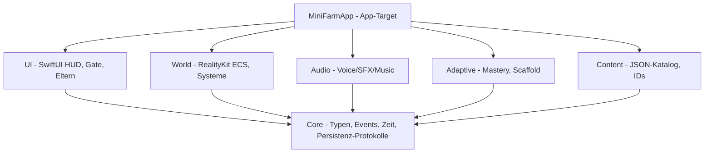

# 15 – Technische Architektur (Swift + RealityKit)

> Native Implementierung in **Swift** mit **RealityKit** (SwiftUI-Host, `RealityView`). Datengetriebene Inhalte, Entity-Component-System, lokale Persistenz, deterministische Adaptiv-Logik, strikt offline.
>
> ⚠️ **Stand-Hinweis (Nov 2026):** API-Verfügbarkeiten wurden recherchiert, aber vor Implementierung gegen die aktuelle Apple-Dokumentation prüfen („Stand prüfen“).

## 1. Plattform und Mindestanforderungen

| Thema | Entscheidung |
|---|---|
| Sprache | Swift 6 (Strict Concurrency), SwiftUI |
| 3D | RealityKit (`RealityView`) |
| Mindest-OS | **iOS/iPadOS 18** (Empfehlung); iOS-26-Features optional per `#available` |
| Geräte | iPhone (ab ~iPhone 12 / A14), iPad (ab ~9. Gen / A13) |
| Orientierung | Querformat primär; Hochformat unterstützt |
| Architektur | Modulares Swift Package + App-Target |
| Abhängigkeiten | **Keine** Third-Party-SDKs (Kids Category: keine Analytics/Ads); optional reine Swift-Utility-Pakete ohne Netzwerk |
| Build-Tools | Xcode, Reality Composer Pro, Swift Testing/XCTest, SwiftLint/swift-format |

**API-Verfügbarkeit (recherchiert, Stand prüfen):**
- `OrthographicCameraComponent` und `LowLevelMesh`: ab iOS 18.
- `MeshInstancesComponent` (GPU-Instancing): **nur iOS 26+** → Fallback für iOS 18/25 nötig (Entity-Cloning/Batching, `LowLevelMesh`-Merging).
- Kameragestaltung in RealityView: virtuelle Kamera (`.virtual`-Modus/`PerspectiveCameraComponent`).

## 2. Modul-Struktur



| Modul | Verantwortung |
|---|---|
| **Core** | Basistypen (IDs, Enums, `GrowthStage`, `Lane`), Event-Bus, Zeit-/Tick-Modell (Hoftag, Sonnenbogen), Protokolle (Persistenz, Audio-Service) |
| **Content** | Laden/Validieren der JSON-Kataloge (Kulturen, Tiere, Aktivitäten, Voicelines), Referenz-Integrität |
| **World** | Szenen-Aufbau, ECS-Komponenten/Systeme, Kamera-Rig, Interaktion, Fahrzeuge, Wachstum |
| **Adaptive** | Signale, Mastery, Scaffold-State-Machine, Wunsch-Generator |
| **Audio** | Voice-Queue, Prioritäten, Ducking, Buses, Spatial SFX, Musik |
| **UI** | HUD, Profilwahl, Elternbereich, Parental Gate, Hofbuch |
| **Persistence** | Speichern/Laden (Codable-JSON oder SwiftData), Migration, Autosave |
| **DevTools** | (nur Debug) Debug-Overlay, Cheats, Simulatoren, Content-Validator |

**Regeln:** Abhängigkeiten nur nach unten (→ Core). `World` kennt `Audio` nur über Protokoll/Events. Keine zyklischen Referenzen.

## 3. Spielschleife und Zeit

- **Zeitmodell:** *Keine Echtzeit-Uhr.* `DayClock` wird durch **Aktions-Ticks** vorangetrieben (Doc 03): Sonnenbogen bewegt sich pro erledigtem Wunsch (+1,0) und Aktivitäts-Tick (+0,25); Kamera-/Idle-Animationen laufen unabhängig im Render-Takt.
- **Update-Modell:** RealityKit `System`s (ECS) pro Frame (`update(context:)`), Gameplay-Logik als **Event-/State-Machines**, nicht als `Timer`.
- **Fixed vs. variable Schritte:** Gameplay-Logik ereignisbasiert; Physik/Bewegung (Fahrzeuge) variable `deltaTime` mit Clamping (≤ 1/20 s).
- **Pausenverhalten:** App-Hintergrund → Audio pausiert, Autosave; Rückkehr → sanfter Wiedereinstieg (Pelle: „Da bist du wieder!“).

## 4. ECS-Entwurf (RealityKit)

### 4.1 Komponenten (Auszug)

| Komponente | Daten | Zweck |
|---|---|---|
| `InteractableComponent` | `id`, `kind`, `hitRadius`, `cueable` | Antippbar/Ziehbar, Cue-Highlight |
| `DraggableComponent` | `snapTargets`, `magnetRadius` | Ziehen & Einrasten |
| `CropComponent` | `cropId`, `state`, `nightsLeft`, `bed` | Wachstums-Zustandsmaschine |
| `AnimalComponent` | `animalId`, `mood`, `wishes` | Tier-Verhalten |
| `VehicleComponent` | `kind`, `mode (auto/lane/wheel)`, `path` | Fahrzeug-Steuerung |
| `WishBubbleComponent` | `wishId`, `giver`, `activity` | Wunsch-Blase an Figur |
| `CueComponent` | `level (0–4)` | Scaffold-Visualisierung |
| `SeasonTintComponent` | `materialParams` | Saison-Variation |
| `AudioEmitterComponent` | `sfxSet`, `loop` | Räumlicher Sound |
| `PelleComponent` | `focus`, `emotion` | Begleiter-Steuerung |

### 4.2 Systeme (Auszug)

| System | Aufgabe |
|---|---|
| `InputSystem` | Touch → `Intent`s (Primär-Touch, Magnet, Palm-Filter) |
| `DragSystem` | Folgen mit Lerp, Einrasten, Rückkehr |
| `GrowthSystem` | Nacht-Wachstum, Zustände, Material-Swap |
| `AnimalBehaviorSystem` | State-Machine (idle/wandern/fressen/schlafen/freuen) |
| `VehicleSystem` | Autopilot, Spur-Magnet, Lenkrad, Feld-Abdeckung |
| `CameraRigSystem` | Rig→Yaw→Pitch→Dolly, Fahrten, Cutaway, Reduce-Motion |
| `SeasonSystem` | LUT/Licht/Partikel/Material-Blend |
| `ScaffoldSystem` | Hilfe-Stufen visualisieren (Cue, Ghost-Hand) |
| `WishSystem` | Blasen, Lebenszyklus |
| `IdleLifeSystem` | Umgebungsleben (Schmetterlinge, Vögel) |

### 4.3 Intents (Eingabeabstraktion)

```swift
enum Intent {
    case tap(EntityID)
    case dragBegan(EntityID), dragMoved(EntityID, SIMD3<Float>), dragEnded(EntityID, zone: ZoneID?)
    case steer(angle: Float, throttle: Float)
    case selectTool(ToolID)
    case askPelle
    case goHome
}
```
Touch, **Autopilot**, **Ghost-Hand**, **Testskripte** und **UI-Automation** erzeugen dieselben `Intent`s → deterministisch testbar.

## 5. Kamera und Rendering

- **Kamera-Rig:** `Rig → Yaw → Pitch → Dolly → Camera` als Entity-Hierarchie; Standard Iso: Yaw 45°, Pitch 38° (Doc 04).
- **Projektion:** Perspektive mit schmalem FOV (22–28°) als Default; **Orthografie als Spike** (A/B auf Wirkung/Tiefe/Performance), da `OrthographicCameraComponent` ab iOS 18 verfügbar ist.
- **Fahrt zu Orten:** Bézier/Spline mit Easing, 0,8–1,5 s, ruckfrei; Reduce Motion → Überblendung statt Fahrt.
- **Cutaway:** Dächer/Wände per Opacity-/Clip-Shader transparent, wenn Kamera/Fokus im Gebäude.
- **Instancing:** Pflanzen/Gras/Zäune: iOS 26+ `MeshInstancesComponent`; ältere OS: Batching über `LowLevelMesh` bzw. wenige Instanz-Entities mit gemeinsamen Materialien.
- **Schatten:** nur Hauptlicht; Contact-Blobs für Kleinteile.
- **Frame-Ziel:** 60 fps (Pro-Motion: 60 fixieren, nicht 120 – Akku/Wärme); Low Power Mode → 30 fps, reduzierte Partikel.

## 6. Daten und Content (datengetrieben)

Alle Inhalte sind **JSON + Assets**, referenziert über stabile IDs (Doc 16, 21):
`crops.json`, `animals.json`, `activities.json`, `items.json`, `machines.json`, `seasons.json`, `economy.json`, `adaptive.json`, `voicelines.json`, `locations.json`, `hofbook.json`.

- **Validator (Build-Schritt):** Referenzen (Item→Kultur), Duplikat-IDs, fehlende Audio-Dateien, Zahlenbereiche, Lokalisierung.
- **Hot-Reload (Debug):** JSON neu laden ohne Neustart.
- **Schema-Version** in jeder Datei (`schemaVersion`).

## 7. Persistenz

| Thema | Entscheidung |
|---|---|
| Speicherform | **Codable-JSON** pro Profil (`Profile.json`, `World.json`, `Skills.json`) – einfach, nachvollziehbar; Alternative SwiftData bei Bedarf |
| Ort | App-Container (`Application Support`), **kein iCloud-Sync** (Datenschutz); optional später iCloud für Familien (nur wenn Kids-konform) |
| Autosave | Nach jeder Aktivität, vor Nacht-Zeitraffer, beim `scenePhase` → background |
| Atomar | Schreiben in Temp-Datei + Rename; Backup der letzten Version (`.bak`) |
| Migration | `schemaVersion` + Migrationsfunktionen je Version; Tests mit alten Fixtures |
| Korruptionsschutz | Prüfsumme; Fallback auf `.bak`; im Notfall Hofzustand „weich“ zurücksetzen (Kind verliert nie alles: Hofbuch separat sichern) |
| Löschen | Profil löschen im Elternbereich (Gate) – entfernt alle Daten + Audio-Aufnahmen |

## 8. Adaptive Engine (Implementierung)

- Reine Swift-Logik ohne RealityKit-Abhängigkeit → **unit-testbar**.
- Eingaben: Ereignisstrom (`ActivityStarted`, `Attempt(correct:)`, `HintShown`, `Completed(assistLevel)` …).
- Ausgaben: Parameter je Aktivität (`ActivityParams`), Scaffold-Anweisungen, Wunsch-Vorschläge.
- Konstanten in `adaptive.json`; Simulationstests mit synthetischen Kind-Modellen (Doc 10 §10).
- Events werden **nur lokal** gehalten (Ringpuffer + aggregierte Statistik), nie gesendet.

## 9. Audio-Integration

- **AudioService** (Protokoll in Core) → Implementierung in Audio-Modul mit `AVAudioEngine`; RealityKit-Audio für räumliche Tier-/Maschinen-SFX (`AudioPlaybackController`).
- **VoiceDirector:** Priorität, Warteschlange, Cooldown, Varianten-Auswahl, Ducking (Doc 12 §5–6).
- **Prefetch:** Beim Tagesstart werden die Zeilen der anstehenden Wünsche vorgeladen.
- **Speicher:** Audio-Dateien gestreamt/memory-mapped; große Musik `AVAudioFile`-gestreamt.
- **On-Demand-Resources** (optional) für Sprachpakete (EN später) und Saison-Musik.

## 10. Performance-Budget

| Metrik | Ziel |
|---|---|
| Framerate | 60 fps stabil (iPhone 12+, iPad 9) |
| Sichtbare Dreiecke | ≤ ~150k |
| Draw Calls | ≤ ~300 (nach Instancing/Batching) |
| Speicher | ≤ 1,2 GB (iPhone), ≤ 2 GB (iPad) – Jetsam-Grenzen beachten |
| Textur-Speicher | ≤ 300 MB |
| Ladezeit (Kaltstart → spielbar) | ≤ 5 s |
| Wechsel Ort/Szene | ≤ 1 s sichtbar (Streaming der Orts-Chunks) |
| Thermik | Kein Throttling in 30-min-Session (Profiling) |
| Akku | ≤ 12 %/Stunde (Zielwert, iPhone) |
| App-Größe | Ziel ≤ 1 GB (inkl. Audio, kompr.) |

**Maßnahmen:** LOD, Instancing, Atlas-Texturen, Culling pro Ort (Chunk), Partikel-Limits, Audio-Voices-Limit (≤ 24), Low-Power-Mode-Anpassung, Thermal-State-Beobachtung (`ProcessInfo.thermalState`) → Effekte reduzieren.

## 11. Teststrategie

| Ebene | Inhalt |
|---|---|
| **Unit** | Adaptive-Engine, Wunsch-Generator, Wachstums-Zustände, Economy, Content-Validator, Grammatik-Lookup (Voicelines) |
| **Property/Simulation** | Synthetische Kinder, 10.000 simulierte Tage, Invarianten („jeder Wunsch lösbar“, „kein Dead-End“) |
| **Integration** | Szenen-Aufbau, Intent→Weltänderung, Speichern/Laden-Roundtrip |
| **UI-Tests (XCUITest)** | Parental Gate, Profil-Anlage, Navigation |
| **Snapshot/Visual** | Referenzbilder je Saison/Ort (Toleranz) |
| **Performance** | `XCTMetric`/Instruments auf Referenzgeräten; Perf-CI-Check |
| **Autopilot-Playthrough** | Bot spielt automatisch 30 Hoftage über Intents; prüft Soft-Locks |
| **Barrierefreiheit** | VoiceOver-Pfade Elternbereich, Reduce Motion, Kontrast |

**Invarianten (Soft-Lock-Freiheit):** (1) Jeder offene Wunsch hat einen lösbaren Pfad. (2) Zu jedem Zeitpunkt existiert ≥ 1 verfügbarer Wunsch. (3) Speichern/Laden ist idempotent. (4) Kein Zustand ohne Rückweg („Home“).

## 12. Build, CI, Releases

- **CI** (Xcode Cloud/GitHub Actions + macOS Runner): Build, Unit-Tests, Content-Validator, Audio-Manifest-Check, Lint.
- **Konfigurationen:** Debug (Cheats/Overlay), Release (strip), Profiling.
- **TestFlight:** Familien-Tests (Kids-Category beachten: Tester-Daten).
- **Lokalisierung:** String-Katalog nur für Elternbereich; Audio-Sets je Sprache.
- **Crash-Reports:** Nur **Apple-System-Crashlogs (Organizer)** – keine Third-Party-SDKs.

## 13. Risiken und technische Spikes

| Spike | Frage | Erfolgskriterium | Phase |
|---|---|---|---|
| S1 Kamera | Perspektive-schmal vs. Ortho: Wirkung, Lesbarkeit, Kosten | A/B-Entscheid mit Testkindern | 0 |
| S2 Instancing | 5.000 Pflanzen/Gras auf iPhone 12 mit 60 fps (iOS 18 vs. 26) | ≥ 55 fps | 0 |
| S3 Touch/Drag | Magnet, Palm-Filter, Primär-Touch in RealityView | 0 Fehlgriffe in Test | 0 |
| S4 Audio-Mix | Voice-Ducking, Prefetch, Latenz | < 300 ms, kein Knacken | 0 |
| S5 Animation | Skelett + Blendshapes in RealityKit, USD-Pipeline | Pelle spricht + zeigt | 0 |
| S6 Cutaway | Transparenz/Clip-Shader performant | ≤ 1 ms/frame | 1 |
| S7 Persistenz | Migration/Korruptions-Tests | alle Fixtures laden | 1 |
| S8 Ladezeiten | Orts-Streaming/Chunking | < 1 s Wechsel | 1 |

**Hauptrisiken:** RealityKit-Eigenheiten bei 2.5D-Kamera/Ortho, Instancing-Verfügbarkeit (iOS-26-only), Audio-Prosodie bei dynamischen Sätzen, Content-Menge (Animationen), Kinder-Touch-Eigenheiten. Gegenmaßnahmen: früh Spikes, datengetriebene Inhalte, Platzhalter-Pipeline.
