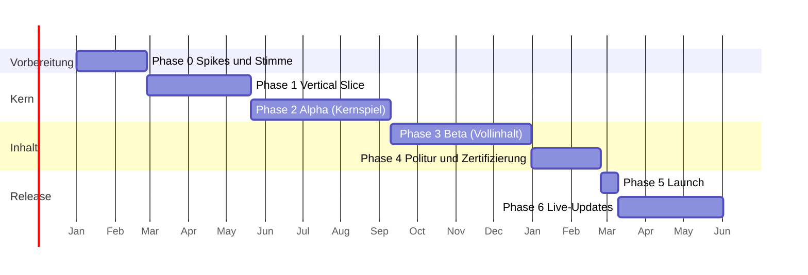

# 19 – Roadmap, MVP und Vertical Slice

> Ziel: Das Spiel in überprüfbaren Schritten entstehen lassen. **Früh spielbar, früh mit Kindern testen, Inhalte nach Bedarf erweitern.** Zeitangaben sind Richtwerte für ein kleines Team (siehe §6) und müssen nach Phase 0 neu kalibriert werden.

## 1. Phasenübersicht

(Gantt dient nur der Struktur; Startdatum ist ein Platzhalter.)

## 2. Phasen im Detail

### Phase 0 – Spikes und Stimme (≈ 8 Wochen)
**Ziel:** Technische und gestalterische Risiken klären, Stimme festlegen.

| Arbeitspaket | Ergebnis / Kriterium |
|---|---|
| S1 Kamera (Perspektive vs. Ortho) | Entscheid dokumentiert, Testkinder-Feedback |
| S2 Instancing/Performance | 5.000 Pflanzen ≥ 55 fps auf iPhone 12 |
| S3 Touch/Drag/Magnet | 0 Fehlgriffe bei Kindern (3 Testkinder) |
| S4 Audio-Mix & Voice-Director | Ducking, Prefetch, Latenz < 300 ms |
| S5 Animations-Pipeline (Blender → USD → RCP) | Pelle spricht, zeigt, geht |
| **Stimmen-Findung** (ElevenLabs MCP) | Pelle-Voice-ID fixiert; 30 Prototyp-Zeilen A/B-Test |
| Art-Prototyp | Stil-Tile: Pelle + Kuh + Beet + Traktor in 1 Szene |
| Rechts-/Lizenz-Check | Voice-/Musik-Lizenzlage dokumentiert |

**Gate (Go/No-Go):** Alle Spikes ≥ „machbar“ oder Alternativplan.

### Phase 1 – Vertical Slice (≈ 12 Wochen)
**Ziel:** Ein vollständig spielbarer, polierter Ausschnitt, der das **Gefühl** des Spiels zeigt.

**Umfang (Slice):**
- 1 Hofstufe-Ausschnitt (Hofstufe 1–2): Hof, Feld, Stall, Hofladen-Stand.
- **Pelle** vollständig animiert + Voice (≈ 600 Zeilen, Doc 13).
- 2 Nutztiere (Huhn, Kuh) plus Hofkatze Minka mit Interaktionen.
- 4 Kulturen (Radieschen, Karotte, Salat, Kartoffel) – 4 Wachstumsstufen.
- Maschinen: Traktor + Pflug (Autopilot + Spur-Ziehen; Lenkrad als Prototyp).
- Aktivitäten (≈ 12): pflügen, säen, gießen, ernten, füttern, streicheln, Eier, melken, Regal füllen, Bestellung, Alle ins Bett, Tag-Zyklus.
- **Alle 3 Stages** spielbar (Keimling/Spross/Blüte) mit Adaptiv-Engine (Basis).
- Tagesablauf mit Sonnenbogen, Nacht-Zeitraffer, Hofbuch (Basis).
- 1 Jahreszeit (Frühling) + Sommer-Preview.
- Elternbereich-Kern (Gate, Profil, Lautstärke).
- Speichern/Laden.

**Gate:** Playtest mit **≥ 8 Kindern** (je 2–3 pro Stage): Kriterien in Doc 20 (z. B. ≥ 80 % beginnen selbstständig, 0 Frust-Abbrüche, „nochmal spielen“-Wunsch).

### Phase 2 – Alpha (Kernspiel) (≈ 16 Wochen)
- Hofstufen 1–5 vollständig (Orte, Unlocks, Hofbaum).
- Alle Nutztiere (9 Arten), alle Kulturen (14), alle Maschinen (11).
- Hofladen komplett, Hofküche, Dorfmarkt (Basis).
- Vier Jahreszeiten (Visuals, Musik/Ambient), Wetter.
- Wunsch-Generator vollständig; ~39 Aktivitäten implementiert (Doc 09).
- Adaptive Engine vollständig mit Tuning-Daten.
- Co-Play (iPad), Profile (4).
- Audio: vollständiger Zeilen-Satz in Rohform, Musik-Prototypen.
- **Gate:** Soft-Lock-freier Autopilot-Playthrough 30 Tage; Perf-Ziele.

### Phase 3 – Beta (Vollinhalt) (≈ 16 Wochen)
- Content-Politur (Animationen, SFX, Musik final), vollständige Voice-QA.
- Feste (4), Hofbuch (alle Einträge), Deko/Wunschzettel.
- Barrierefreiheit komplett (Doc 18), Ruhig-Modi.
- Lokalisierung Englisch (Audio) – optional Phase 6.
- TestFlight-Beta mit Familien (Kids-Category-konform, kleine Gruppe).
- **Gate:** Playtest ≥ 20 Kinder; keine Blocker; Kids-Category-Checkliste grün.

### Phase 4 – Politur und Zertifizierung (≈ 8 Wochen)
- Performance/Thermik/Akku-Feinschliff, Crashfreiheit (≥ 99,8 % crashfrei in Beta).
- App-Store-Material (Screenshots, Preview-Video, Beschreibung), Datenschutzerklärung, Privacy Manifest.
- Review-Vorbereitung (Reviewer-Notizen, Gate-Anleitung).
- Juristische Prüfung (Doc 17).

### Phase 5 – Launch (≈ 2 Wochen)
- Release, Presse-/Eltern-Blogger-Outreach (ruhig, ehrlich), Support-Setup.

### Phase 6 – Live-Updates (laufend)
- Zusätzliche Inhalte: neue Tiere, Feste, Kulturen; Englisch; weitere Sprachen; Feinabstimmung der Adaptivität aus Support-Feedback.
- Optional: iPad-Co-Play-Erweiterungen, Familien-Hofbuch-Export (PDF für Eltern, lokal).

## 3. MVP-Definition (Minimum Lovable Product)

Das **MVP** (= Veröffentlichbar) ist **Ende Phase 3/4**, nicht der Slice. Muss-Kriterien:

| Bereich | MVP-Muss |
|---|---|
| Spielkern | Felder + Tiere + Laden + Hofküche (Basis) + Hofstufen 1–4 |
| Stages | Alle 3 mit Adaptivität |
| Voice | Vollständig Deutsch |
| Jahreszeiten | 4 (mit 1 Fest je Saison) |
| Eltern | Gate, Profile, Einstellungen, Timer, Datenschutz |
| Barrierefreiheit | Doc 18 Muss-Teil (Reduce Motion, Untertitel, Kontrast, VoiceOver Elternbereich) |
| Qualität | 60 fps, keine Soft-Locks, keine Datenverluste |

**Später (nach MVP):** Hofstufe-5-Extras (Dorfmarkt voll), Englisch, zusätzliche Tiere, Familien-Export, Mini-Hof-Lite.

## 4. Nicht-Ziele (bewusst nicht)

- Kein Multiplayer online, keine Chats, keine Rangliste, keine Cloud-Konten.
- Keine Werbung, keine IAP, kein Abo, keine Zufalls-Belohnungen (Lootboxen).
- Keine Verlust-/Fail-Zustände, keine Zeitlimits, keine Konkurrenz-NPCs.
- Keine Echtzeit-Mechaniken (Tiere verhungern, Ernte verdirbt).
- Keine Spracherkennung/Mikrofon-Gameplay.
- Keine Android-/Web-Version (nur iOS/iPadOS; visionOS/macOS später prüfen).
- Keine Texteingabe durch Kinder.
- Keine realistische Landwirtschafts-Simulation (Pestizide, Schlachtung, Tierhandel o. Ä.).

## 5. Risiko-Register

| # | Risiko | Wahrsch. | Auswirkung | Gegenmaßnahme |
|---|---|---|---|---|
| R1 | Content-Menge (Animationen, Audio) sprengt Budget | hoch | hoch | Datengetriebene Pipeline, Rig-Sharing, Slice-first, Scope-Cut-Liste (§7) |
| R2 | Kinder-Touch funktioniert schlecht | mittel | hoch | Spike S3 früh, Playtests ab Phase 0 |
| R3 | Prosodie bei dynamischen Sätzen klingt holprig | mittel | mittel | Baustein-Sprache, Vorab-Kombinationen (Doc 13 §5) |
| R4 | KI-Stimmen-Lizenz/Akzeptanz | niedrig–mittel | hoch | Frühe Prüfung, Alternativen (Sprecher:in) |
| R5 | Performance auf älteren Geräten | mittel | mittel | Budgets, LOD, Low-Power-Modus, Min-Gerät festlegen |
| R6 | RealityKit-Einschränkungen (Cutaway, Ortho, Instancing) | mittel | mittel | Spikes S1/S2/S6, Fallbacks |
| R7 | Adaptivität wirkt unnatürlich | mittel | mittel | Simulation + Playtests, konservative Defaults, Eltern-Override |
| R8 | App-Store-Review (Kids) | niedrig | hoch | Checkliste, Reviewer-Notizen |
| R9 | Scope Creep | hoch | mittel | Nicht-Ziele, Gate-Reviews |
| R10 | Wenig Testkinder verfügbar | mittel | mittel | Kooperationen (Kitas/Eltern), Datenschutzkonforme Tests (Doc 20) |

## 6. Team- und Aufwandsannahmen (Autopilot-Annahme)

Annahme: **kleines Kernteam** (1–2 Entwickler:innen Swift/RealityKit, 1–2 3D-Artists/Animator:innen, 1 Audio/Sprachregie (Teilzeit), 1 Pädagogik-Beratung (punktuell), Playtest-Koordination). Bei Solo-Entwicklung: Zeitrahmen ×2–3, Inhalte reduzieren (Scope-Cut-Liste).

## 7. Scope-Cut-Liste (falls Zeit/Budget knapp)

Reihenfolge der Kürzung (zuerst streichen):
1. Dorfmarkt (Hofstufe 5), Hofstufe-5-Extras.
2. Einzelne Kulturen/Tiere (z. B. Ziege, Pferd, Kürbis) – Katalog bleibt datengetrieben, später nachliefern.
3. Aufwendige Maschinen (Ballenpresse, Kartoffelroder) → Autopilot-only-Varianten.
4. Eltern-Stimmen/Kindname-Aufnahme.
5. Musik-Vielfalt (statt 4 Themen: 2 + Ambient).
6. Co-Play-Zweicursor (iPad).
7. Englisch.

**Nicht streichbar:** Voice-First-Konzept, Adaptive Hilfe, Autopilot, Elternbereich/Gate, Barrierefreiheits-Muss-Teil, Datenschutz.

## 8. Erfolgskriterien (Produkt)

| Kriterium | Ziel |
|---|---|
| Kinder-Playtests | ≥ 85 % der Kinder starten selbstständig; ≥ 90 % wollen „nochmal“ spielen |
| Frustabbrüche | < 5 % der Aufgaben |
| Elternfeedback | ≥ 4,5/5 bei „entspannend“ |
| Crash-Freiheit | ≥ 99,8 % Sessions |
| App-Store-Bewertung | ≥ 4,6 |
| Support | Reaktion ≤ 2 Werktage |
